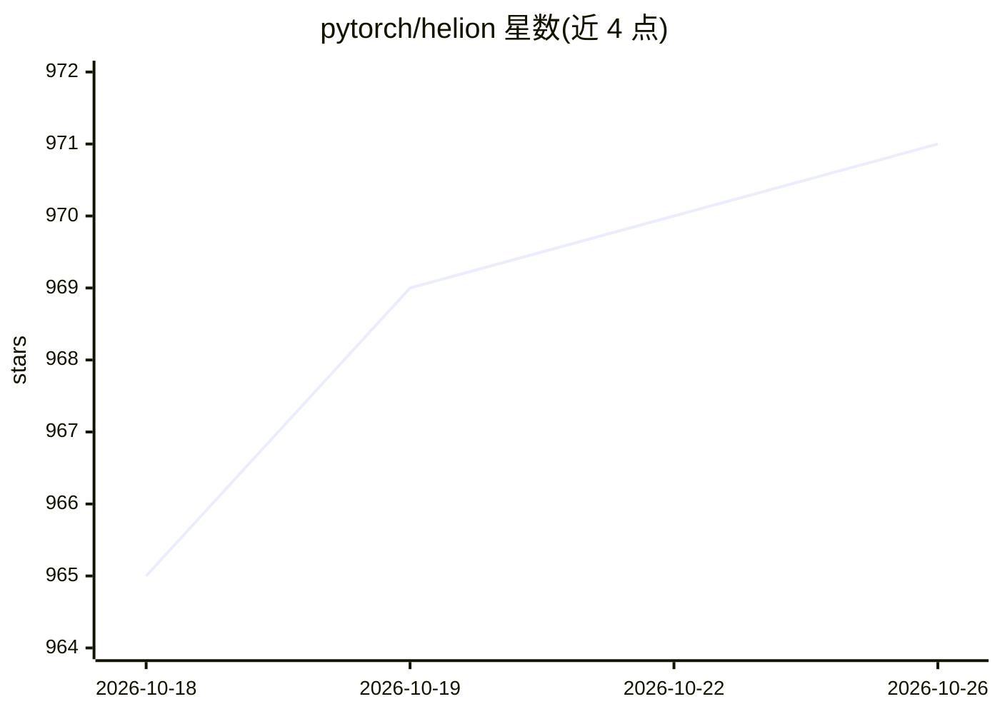

# pytorch/helion

⭐ 971 · Python · BSD-3-Clause · 推送 2026-10-25 · [GitHub](https://github.com/pytorch/helion) · 组织维护

**Python 嵌入式 DSL：帮开发者高效编写 GPU ML 内核**

PyTorch 官方维护的 Python 嵌入式领域专用语言，用于编写机器学习内核并编译到 Triton 后端。循环外代码为标准 PyTorch CPU 代码，循环内代码编译为单个 GPU 内核。通过自动调优（autotuning）自动决定 tile 尺寸、索引策略、网格映射、循环归约等，减少手写 Triton 代码量；调优约需 10 分钟，生产环境建议使用预调优配置。另支持 Blackwell GPU 的 TileIR 后端与 CUDA 13+ 的 CuTe beta 后端。

## 筛选速览

| 维度 | 判定 | 备注 |
|---|---|---|
| AI 角色 | `ai-ecosystem` | LLM/agent 周边工具 |
| 许可风险 | `permissive` | BSD-3-Clause |
| 部署形态 | `library` | 以包/库形式分发 |
| 模型依赖 | — | README 未给出锁定关系 |
| 硬件要求 | — | 无带数字的原话,不猜 |
| 安装摩擦 | `medium` | 含编译或系统依赖之一 |
| 成熟度 | `idea` | |

## 能力要点

- Python 嵌入式 DSL 编译到 Triton，循环内代码生成单个 GPU 内核
- 自动调优覆盖 tile 尺寸、索引策略、grid 映射、循环展开等配置空间
- 静态形状按 shape 签名分别特化调优，可设 static_shapes=False 共享配置
- 可选 TileIR（Blackwell）与 CuTe（CUDA 13+，beta）后端

## 适用场景

- 用 PyTorch 风格代码编写矩阵乘、softmax 等高性能 GPU 内核
- 减少手写 Triton 内核的样板代码与手动调参工作量
- 通过 ahead-of-time 调优配置在生产环境部署内核

## 场景标签

 · 领域:ML 编译器/GPU 内核开发

## 证据(README 行号)

> L10: **Helion** is a Python-embedded domain-specific language (DSL) for
> L11: authoring machine learning kernels, designed to compile down to [Triton],

## 星数曲线

2026-10-18 965 → 2026-10-26 971（+6）

---
*卡片 v1 · prompt 1.4 · 生成 2026-10-21 · 置信度 high · 依据 README sha `d3f4b23e5c4d` · [字段定义](../../DATASET.md)*
