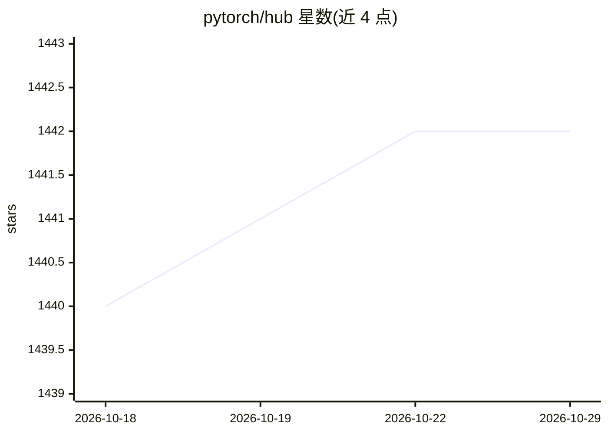

# pytorch/hub

⭐ 1,442 · Python · 推送 2026-10-03 · [GitHub](https://github.com/pytorch/hub) · 组织维护

**PyTorch Hub 模型收录仓库：通过 PR 提交模型条目上官网**

pytorch.org/hub 网站内容的提交入口：模型作者在仓库中添加 hubconf.py 并按模板提交 markdown 条目文件，PR 合并后约 24 小时内展示在 PyTorch 官网。面向发布预训练模型的开发与科研用户。仓库不托管模型权重，权重需作者自行部署；提供本地校验脚本（sanity_check.py、run_pytorch.sh），CI 会拼接 markdown 中的 python 代码块并基于最新 PyTorch release 运行，标签集由 scripts/tags.py 预定义，另有 netlify bot 生成网页预览。

## 筛选速览

| 维度 | 判定 | 备注 |
|---|---|---|
| AI 角色 | `ai-knowledge` | 知识聚合/清单类 |
| 许可风险 | `none` | — |
| 部署形态 | `None` |  |
| 模型依赖 | — | README 未给出锁定关系 |
| 硬件要求 | — | 无带数字的原话,不猜 |
| 安装摩擦 | `low` | 无编译、无系统依赖或容器化 |
| 成熟度 | — | 结构信号不足 |

## 能力要点

- 通过 PR 提交模型条目，合并后 24 小时内上官网
- CI 自动执行 markdown 中的 python 代码块做验证
- 不托管预训练权重，作者需自行部署
- netlify bot 提供模型网页预览

## 适用场景

- 将自己的预训练模型发布到 PyTorch Hub 供他人通过 torch.hub.load 使用
- 查阅模型条目提交规范与本地测试流程

## 场景标签

 · 领域:深度学习/模型目录

## 证据(README 行号)

> L7: We accept submission to PyTorch hub through PR in `hub` repo. Once the PR is merged into master here, it will show u
> L12: 2. Create a PR in `pytorch/hub` repo. For each new model you have, create a `<repo_owner>_<repo_name>_<title>.md` f

## 星数曲线

2026-10-18 1,440 → 2026-10-29 1,442（+2）

---
*卡片 v1 · prompt 1.4 · 生成 2026-10-21 · 置信度 high · 依据 README sha `ff1543d367e4` · [字段定义](../../DATASET.md)*
