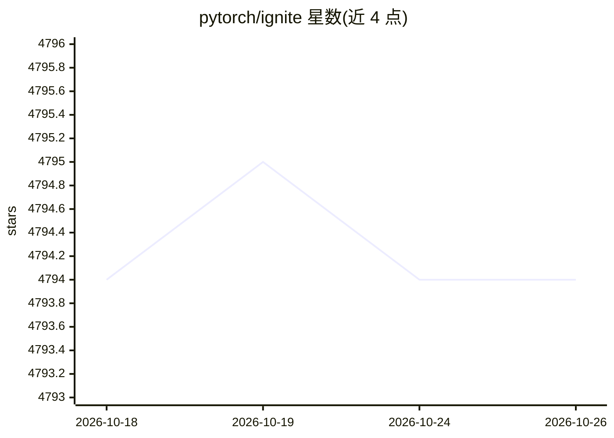

# pytorch/ignite

⭐ 4,794 · Python · BSD-3-Clause · 推送 2026-10-20 · [GitHub](https://github.com/pytorch/ignite) · [官网](https://pytorch-ignite.ai) · 组织维护

**PyTorch 神经网络训练与评测的高层库**

PyTorch 官方生态下的高层训练库：提供 Engine 与事件系统替代手写 epoch/iteration 循环，内置约 20 种回归指标及 Precision/Recall/Accuracy/IoU 等分类与分割指标，支持用算术运算组合派生指标（如 F1）；通过 handlers 组合训练流水线、保存产物与日志。支持分布式训练（native/horovod）与混合精度，提供 pip/conda/源码安装、预构建 Docker 镜像与在线代码生成器。代码以库形式嵌入用户项目，不接管程序控制流。

## 筛选速览

| 维度 | 判定 | 备注 |
|---|---|---|
| AI 角色 | `ai-ecosystem` | LLM/agent 周边工具 |
| 许可风险 | `permissive` | BSD-3-Clause |
| 部署形态 | `self-host` | docker 或自建部署 |
| 模型依赖 | — | README 未给出锁定关系 |
| 硬件要求 | — | 无带数字的原话,不猜 |
| 安装摩擦 | `low` | 无编译、无系统依赖或容器化 |
| 成熟度 | — | 结构信号不足 |

## 能力要点

- Engine + 事件/处理器系统，支持事件过滤与堆叠
- 内置多种指标并可用算术运算组合派生指标
- 提供预构建 Docker 镜像（base/vision/nlp，含 horovod/apex 变体）
- 在线 Code-Generator 生成训练脚本

## 适用场景

- 减少纯 PyTorch 训练循环样板代码
- 在训练过程中挂接验证、检查点与日志处理器
- 复用现成指标做模型评测

## 场景标签

`模型训练` · 领域:训练与推理

## 证据(README 行号)

> L14: Ignite is a high-level library to help with training and evaluating neural networks in PyTorch flexibly and transpa
> L37: Ignite is a **library** that provides three high-level features:

## 星数曲线

2026-10-18 4,794 → 2026-10-26 4,794（+0）

---
*卡片 v1 · prompt 1.4 · 生成 2026-10-20 · 置信度 high · 依据 README sha `c9ccf56da7e4` · [字段定义](../../DATASET.md)*
