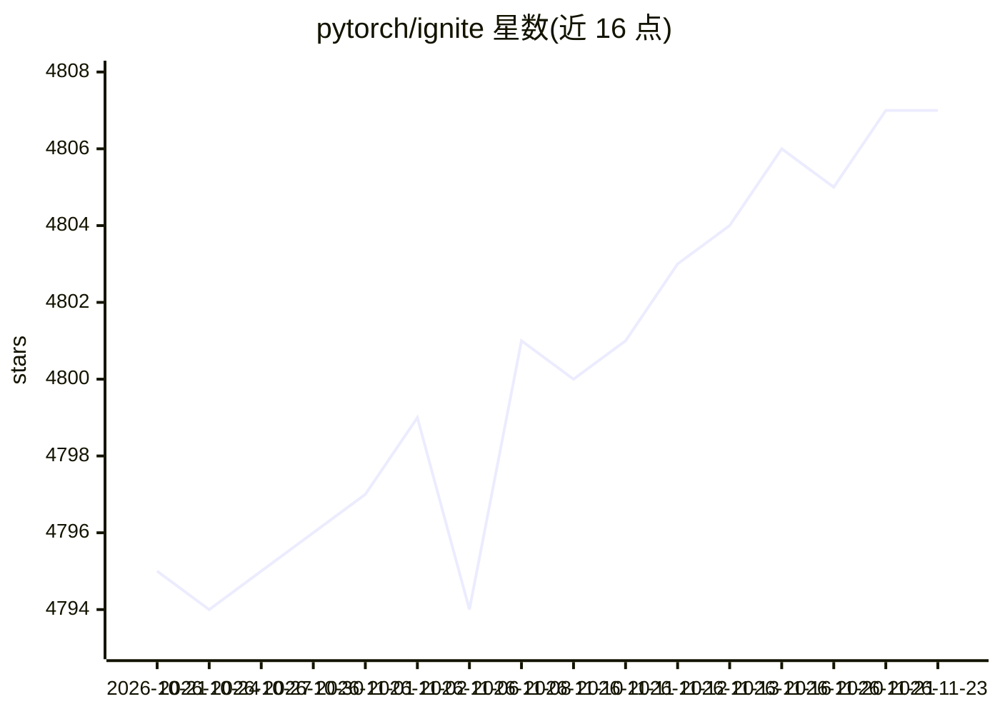

# pytorch/ignite

⭐ 4,807 · Python · BSD-3-Clause · 推送 2026-11-20 · [GitHub](https://github.com/pytorch/ignite) · [官网](https://pytorch-ignite.ai) · 组织维护

**PyTorch 高层库：简化神经网络训练与评估流程**

PyTorch 官方生态中的高层训练库，通过 Engine 与 Events/Handlers 事件系统封装训练与验证循环，免去手写 epoch/iteration 循环；内置约 20 类回归指标及 Precision/Recall/Accuracy/IoU 等分类指标，指标可通过算术运算组合；提供日志、断点保存等内置 handler，支持原生分布式与 horovod。安装覆盖 pip/conda/源码，Docker Hub 提供含 vision/NLP 变体的预构建镜像，并有在线代码生成器生成训练脚本。

## 筛选速览

| 维度 | 判定 | 备注 |
|---|---|---|
| AI 角色 | `ai-native` | 本体是模型或模型工具 |
| 许可风险 | `permissive` | BSD-3-Clause |
| 部署形态 | `self-host` | docker 或自建部署 |
| 模型依赖 | — | README 未给出锁定关系 |
| 硬件要求 | — | 无带数字的原话,不猜 |
| 安装摩擦 | `low` | 无编译、无系统依赖或容器化 |
| 成熟度 | — | 结构信号不足 |

## 能力要点

- Engine 与 Events/Handlers 事件系统封装训练循环，支持事件过滤、堆叠与自定义事件
- 内置约 20 项指标（Precision/Recall/IoU 等），可经算术运算组合新指标
- pip/conda/源码安装，提供 base/vision/NLP 等预构建 Docker 镜像
- 在线 code-generator 生成训练脚本

## 适用场景

- 替代手写 PyTorch 训练与验证循环
- 科研中快速搭建可复现的模型训练基线
- 需要灵活事件钩子做日志、检查点与实验管理
- 分布式或 TPU 环境下的训练任务

## 场景标签

`模型训练` · 领域:训练与推理

## 证据(README 行号)

> L14: Ignite is a high-level library to help with training and evaluating neural networks in PyTorch flexibly and transpa
> L37: Ignite is a **library** that provides three high-level features:
> L265: - Distributed training: native or horovod and using PyTorch native AMP

## 星数曲线

2026-10-21 4,795 → 2026-11-23 4,807（+12）

---
*卡片 v1 · prompt 1.4 · 生成 2026-11-22 · 置信度 high · 依据 README sha `9e90604f22e4` · [字段定义](../../DATASET.md)*
