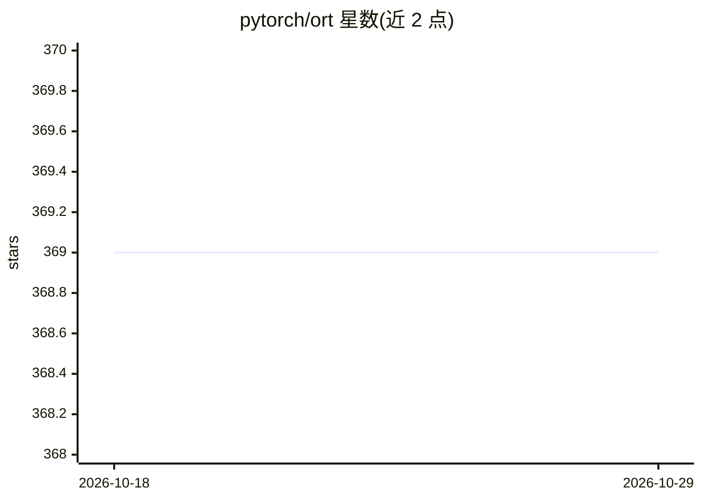

# pytorch/ort

⭐ 369 · Python · MIT · 推送 2026-02-05 · [GitHub](https://github.com/pytorch/ort) · 组织维护

**用 ONNX Runtime 加速 PyTorch 训练与推理的库**

由 PyTorch 组织维护的库，包含三个组件：torch-ort 用 ONNX Runtime 加速大 transformer 模型的训练（以 ORTModule 包装模型，几行代码接入，含 FusedAdam/FP16 优化器与负载均衡分布式采样器）；ort_moe 提供独立于 ONNX Runtime 的 Mixture of Experts 层；torch-ort-infer 基于 ONNX Runtime 与 Intel OpenVINO 在 Intel CPU/iGPU/VPU 上执行推理，支持配置后端与精度组合。训练需 NVIDIA 或 AMD GPU 并安装 CUDA/CuDNN。

## 筛选速览

| 维度 | 判定 | 备注 |
|---|---|---|
| AI 角色 | `ai-ecosystem` | LLM/agent 周边工具 |
| 许可风险 | `permissive` | MIT |
| 部署形态 | `library` | 以包/库形式分发 |
| 模型依赖 | — | README 未给出锁定关系 |
| 硬件要求 | — | 无带数字的原话,不猜 |
| 安装摩擦 | `medium` | 含编译或系统依赖之一 |
| 成熟度 | — | 结构信号不足 |

## 能力要点

- ORTModule 包装 PyTorch 模型接入 ONNX Runtime 训练
- Mixture of Experts 层（独立运行，不依赖 ONNX Runtime）
- torch-ort-infer 经 OpenVINO 在 Intel CPU/GPU/VPU 上推理
- FusedAdam、FP16_Optimizer 与 LoadBalancingDistributedSampler 工具

## 适用场景

- 加速大 transformer 模型的 PyTorch 训练并降低 GPU 成本
- 在 Intel CPU/集成 GPU 上运行 PyTorch 模型推理
- 为模型添加 Mixture of Experts 层

## 场景标签

`推理引擎` `模型训练` · 领域:训练与推理

## 证据(README 行号)

> L19: - torch-ort to train PyTorch models faster with ONNX Runtime
> L21: - torch-ort-infer to perform inference on PyTorch models with ONNX Runtime and Intel® OpenVINO™
> L108: The torch-ort library accelerates training of large transformer PyTorch models to reduce the training time and GPU

## 星数曲线

2026-10-18 369 → 2026-10-29 369（+0）

---
*卡片 v1 · prompt 1.4 · 生成 2026-10-21 · 置信度 high · 依据 README sha `523e501396ee` · [字段定义](../../DATASET.md)*
