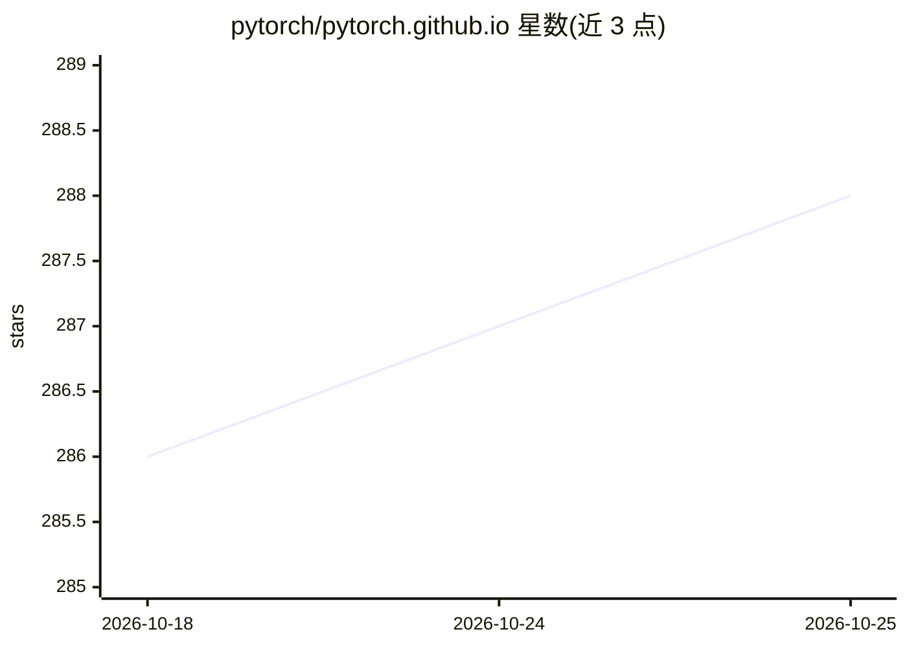

# pytorch/pytorch.github.io

⭐ 288 · HTML · BSD-3-Clause · 推送 2026-10-24 · [GitHub](https://github.com/pytorch/pytorch.github.io) · [官网](https://pytorch.org) · 组织维护

**PyTorch 官网的 Jekyll 静态站点源码仓库**

托管 pytorch.org 的静态网站源码仓库，使用 Jekyll 与 Bootstrap 构建，承载 PyTorch 的官网页面、教程与文档。README 声明本仓库已非官网唯一事实来源，站点现由 PyTorch Foundation 团队单独管理，仅少量文件仍在使用，网站改动需联系该团队而非提交 PR。本地开发需安装 rbenv、ruby-build、nvm、Yarn，通过 make serve 运行、make build 生成静态站点，部署于 GitHub Pages 并经 CircleCI 自动构建。

## 筛选速览

| 维度 | 判定 | 备注 |
|---|---|---|
| AI 角色 | `ai-knowledge` | 知识聚合/清单类 |
| 许可风险 | `permissive` | BSD-3-Clause |
| 部署形态 | `None` |  |
| 模型依赖 | — | README 未给出锁定关系 |
| 硬件要求 | — | 无带数字的原话,不猜 |
| 安装摩擦 | `low` | 无编译、无系统依赖或容器化 |
| 成熟度 | — | 结构信号不足 |

## 能力要点

- Jekyll + Bootstrap 构建的静态站点，托管教程与文档
- make serve 本地运行，make build 输出到 ./_site
- 通过 GitHub Pages + CircleCI 自动部署

## 适用场景

- 查看 pytorch.org 站点的构建与部署方式
- 了解向 PyTorch 文档与教程贡献的入口指引

## 场景标签

 · 领域:开发者文档/网站基础设施

## 证据(README 行号)

> L12: A static website built in Jekyll and Bootstrap for PyTorch, and its tutorials and documentation.
> L83: ## Contributing to PyTorch Documentation and Tutorials

## 星数曲线

2026-10-18 286 → 2026-10-25 288（+2）

---
*卡片 v1 · prompt 1.4 · 生成 2026-10-22 · 置信度 high · 依据 README sha `ca83b1f3db0b` · [字段定义](../../DATASET.md)*
