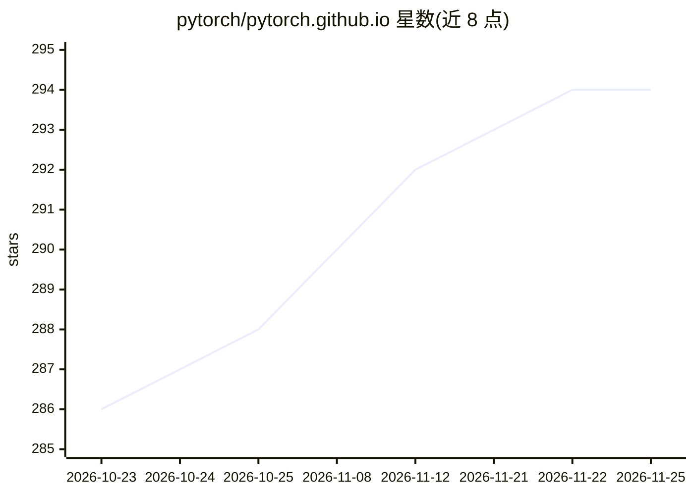

# pytorch/pytorch.github.io

⭐ 294 · HTML · BSD-3-Clause · 推送 2026-11-11 · [GitHub](https://github.com/pytorch/pytorch.github.io) · [官网](https://pytorch.org) · 组织维护

**PyTorch 官网源码：文档与教程静态站点**

PyTorch 官方网站 pytorch.org 的源码仓库，用 Jekyll 和 Bootstrap 构建静态站点，承载 PyTorch 的教程与文档。README 提供本地开发环境搭建步骤：通过 rbenv 安装指定 Ruby 版本、nvm 安装 Node 版本、yarn 管理依赖，用 make serve 本地运行、make build 构建静态站点至 ./_site，站点托管在 GitHub Pages，通过合并到 site 分支由 CircleCI 自动构建部署。仓库已公告将于 2026 年 11 月 9 日当周归档，网站改由 PyTorch Foundation 团队单独管理，仅少数文件仍在使用。

## 筛选速览

| 维度 | 判定 | 备注 |
|---|---|---|
| AI 角色 | `ai-knowledge` | 知识聚合/清单类 |
| 许可风险 | `permissive` | BSD-3-Clause |
| 部署形态 | `None` |  |
| 模型依赖 | — | README 未给出锁定关系 |
| 硬件要求 | — | 无带数字的原话,不猜 |
| 安装摩擦 | `low` | 无编译、无系统依赖或容器化 |
| 成熟度 | — | 结构信号不足 |

## 能力要点

- Jekyll + Bootstrap 构建的 pytorch.org 静态站点源码
- make serve 本地开发、make build 构建静态站点
- GitHub Pages 托管，CircleCI 自动构建部署
- 仓库将于 2026 年 11 月归档，维护转移至 PyTorch Foundation

## 适用场景

- 本地运行或修改 PyTorch 官网页面
- 为 PyTorch 官网添加额外加速器平台条目
- 查找 PyTorch 文档与教程的贡献入口

## 场景标签

`教程课程` · 领域:学习与行业

## 证据(README 行号)

> L17: A static website built in Jekyll and Bootstrap for PyTorch, and its tutorials and documentation.
> L9: > Only a very small number of files in this repo are still actively used. The website is now managed separately by t

## 星数曲线

2026-10-23 286 → 2026-11-25 294（+8）

---
*卡片 v1 · prompt 1.4 · 生成 2026-11-25 · 置信度 high · 依据 README sha `b30e2d8451e0` · [字段定义](../../DATASET.md)*
