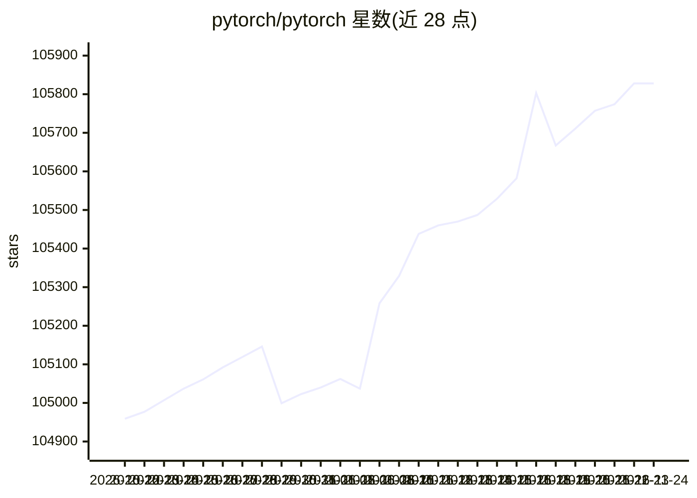

# pytorch/pytorch

⭐ 105,828 · Python · NOASSERTION · 推送 2026-11-22 · [GitHub](https://github.com/pytorch/pytorch) · [官网](https://pytorch.org) · 组织维护

**为 Python 开发者提供 GPU 加速的张量计算与动态神经网络库**

PyTorch 是一个 Python 包，提供两类核心能力：带 GPU 加速的张量计算（类似 NumPy）与基于 tape 的自动求导神经网络构建。组件涵盖 torch 张量库、torch.autograd 自动微分、torch.nn 神经网络库、torch.multiprocessing 与 torch.utils 数据加载工具。安装可经 conda/pip 二进制 wheels，或从源码构建（需 Python 3.11+、C++20 编译器，可选 CUDA/ROCm/Intel GPU 后端），并为 NVIDIA Jetson 平台提供 wheels。

## 筛选速览

| 维度 | 判定 | 备注 |
|---|---|---|
| AI 角色 | `ai-native` | 本体是模型或模型工具 |
| 许可风险 | `none` | NOASSERTION |
| 部署形态 | `desktop` | 安装包/桌面程序 |
| 模型依赖 | — | README 未给出锁定关系 |
| 硬件要求 | — | 无带数字的原话,不猜 |
| 安装摩擦 | `low` | 无编译、无系统依赖或容器化 |
| 成熟度 | — | 结构信号不足 |

## 动量与使用信号

- 维护:`active` — 距上次 push 0.6 天,年发版 8,327 位贡献者
- 涨星:近 1 天 **+27**(自 20261016 起算)
- 安装:pypi 包 `dev` 月下载 1

## 能力要点

- 带 GPU 加速的张量计算库，兼容 NumPy/SciPy/Cython 生态
- 基于反向模式自动微分的动态神经网络构建
- 支持 CUDA、AMD ROCm、Intel GPU 多后端，Jetson 平台 wheels
- 提供 C/C++ 扩展 API 用于自定义算子

## 适用场景

- 用 GPU 上的张量运算替代 NumPy 做科学计算
- 搭建和训练深度学习模型做研究或开发
- 从源码编译定制 CUDA/ROCm 版本的深度学习框架

## 场景标签

 · 领域:机器学习/深度学习框架

## 证据(README 行号)

> L3: PyTorch is a Python package that provides two high-level features:
> L4: - Tensor computation (like NumPy) with strong GPU acceleration
> L5: - Deep neural networks built on a tape-based autograd system

## 星数曲线

2026-10-22 104,959 → 2026-11-24 105,828（+869）

---
*卡片 v1 · prompt 1.4 · 生成 2026-11-22 · 置信度 mid · 依据 README sha `e21ce0d0438f` · [字段定义](../../DATASET.md)*
