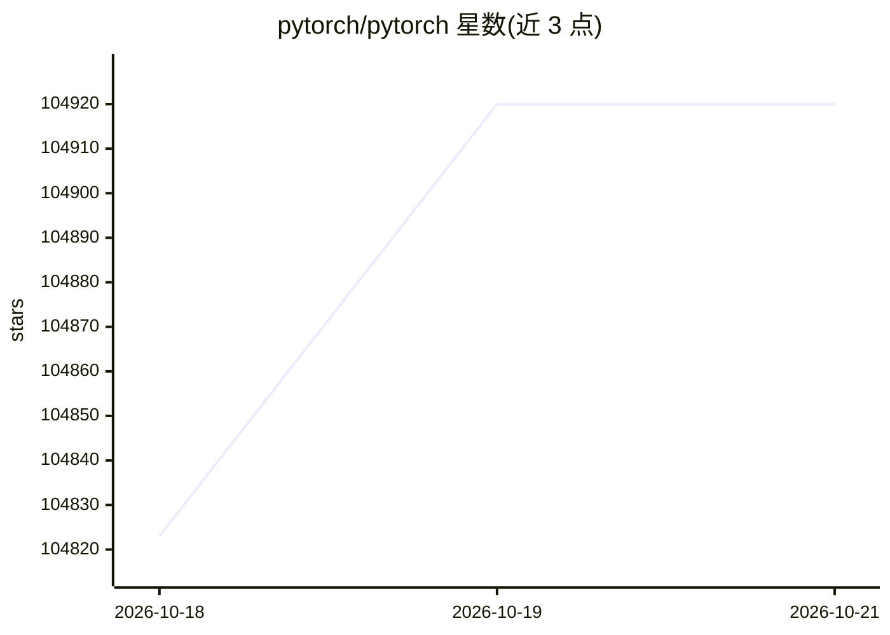

# pytorch/pytorch

⭐ 104,920 · Python · NOASSERTION · 推送 2026-10-19 · [GitHub](https://github.com/pytorch/pytorch) · [官网](https://pytorch.org) · 组织维护

**给开发者的 GPU 加速张量计算与动态神经网络 Python 库**

提供 GPU 加速的 NumPy 式张量计算与基于 tape 机制的自动微分动态神经网络，组件包括 torch、torch.autograd、torch.nn、torch.multiprocessing 与 torch.utils。定位为深度学习研究平台，强调 Python 优先集成、命令式执行、可扩展的 C/C++ 扩展 API。安装途径为官网提供的 conda/pip 二进制，或从源码构建（需 Python 3.10+、C++20 编译器、10 GB 磁盘等），并分别给出 CUDA、ROCm、Intel GPU 的构建说明。

## 筛选速览

| 维度 | 判定 | 备注 |
|---|---|---|
| AI 角色 | `ai-ecosystem` | LLM/agent 周边工具 |
| 许可风险 | `none` | NOASSERTION |
| 部署形态 | `desktop` | 安装包/桌面程序 |
| 模型依赖 | — | README 未给出锁定关系 |
| 硬件要求 | `cpu-ok` | |
| 安装摩擦 | `low` | 无编译、无系统依赖或容器化 |
| 成熟度 | — | 结构信号不足 |

## 动量与使用信号

- 维护:`active` — 距上次 push 0.6 天,年发版 8,327 位贡献者
- 涨星:近 1 天 **+27**(自 20261016 起算)
- 安装:pypi 包 `dev` 月下载 1

## 能力要点

- GPU 加速张量计算与基于 tape 的自动微分
- 组件划分：torch / autograd / nn / multiprocessing / utils
- 支持 CUDA、AMD ROCm、Intel GPU 三类 GPU 后端构建
- 提供二进制（conda/pip）与源码两种安装途径

## 适用场景

- 用 GPU 加速替代 NumPy 做科学计算
- 搭建并训练深度神经网络模型
- 用 Python 编写自定义神经网络层并通过扩展 API 接入 C/C++

## 场景标签

`模型训练` · 领域:训练与推理

## 证据(README 行号)

> L3: PyTorch is a Python package that provides two high-level features:
> L4: - Tensor computation (like NumPy) with strong GPU acceleration
> L112: Commands to install binaries via Conda or pip wheels are on our website: https://pytorch.org/get-started/locally/
> L158: ##### NVIDIA CUDA Support

## 星数曲线

2026-10-18 104,823 → 2026-10-21 104,920（+97）

---
*卡片 v1 · prompt 1.4 · 生成 2026-10-18 · 置信度 high · 依据 README sha `89caefa5d882` · [字段定义](../../DATASET.md)*
