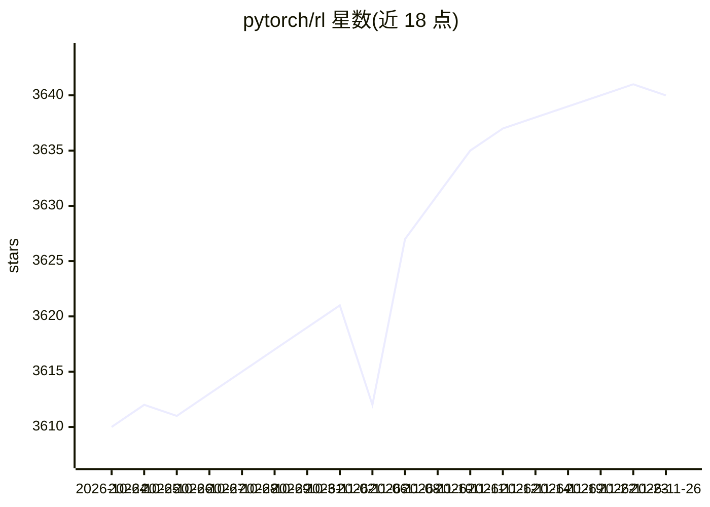

# pytorch/rl

⭐ 3,640 · Python · MIT · 推送 2026-11-25 · [GitHub](https://github.com/pytorch/rl) · [官网](https://pytorch.org/rl) · 组织维护

**面向 RL 研究者的 PyTorch 模块化强化学习工具库**

PyTorch 原生的强化学习与决策工具包，围绕 TensorDict 统一数据模型组织环境、策略、采集器、回放缓冲区与损失模块等可组合组件。支持单进程/异步/多进程/分布式采集执行，提供 PPO、SAC、DQN、Dreamer、MAPPO、QMIX 等算法实现，覆盖机器人控制、离线 RL、基于模型的 RL、模仿学习与多智能体训练，可将策略导出为 ONNX，并提供 Hydra 配置的可复现训练配方。

## 筛选速览

| 维度 | 判定 | 备注 |
|---|---|---|
| AI 角色 | `ai-native` | 本体是模型或模型工具 |
| 许可风险 | `permissive` | MIT |
| 部署形态 | `library` | 以包/库形式分发 |
| 模型依赖 | local-ok | 支持本地模型 |
| 硬件要求 | — | 无带数字的原话,不猜 |
| 安装摩擦 | `medium` | 含编译或系统依赖之一 |
| 成熟度 | — | 结构信号不足 |

## 能力要点

- 以 TensorDict 为统一数据模型的模块化 RL 组件体系
- 单进程/异步/多进程/分布式多种采集器执行模式
- 内置环境包装器覆盖 Gymnasium、DM Control、Isaac Lab、PettingZoo 等
- 算法覆盖 PPO/SAC/DQN/Decision Transformer/MAPPO/QMIX 等多种范式

## 适用场景

- 搭建需要从单机扩展到分布式的强化学习训练流程
- 做多智能体或基于模型的 RL 研究
- 机器人学习中组合底层控制器并导出 ONNX 策略
- 用回放缓冲区处理离线 RL 数据集

## 场景标签

`强化学习` · 领域:训练与推理

## 证据(README 行号)

> L21: TorchRL is a PyTorch-native toolkit for reinforcement learning, decision making,
> L23: narrow benchmark suite: it is a collection of composable pieces for building RL
> L290: Examples include PPO, SAC, DQN, TD3, REDQ, IQL, CQL, Decision Transformer,

## 星数曲线

2026-10-24 3,610 → 2026-11-26 3,640（+30）

---
*卡片 v1 · prompt 1.4 · 生成 2026-11-23 · 置信度 high · 依据 README sha `ebc8f8a1acd7` · [字段定义](../../DATASET.md)*
