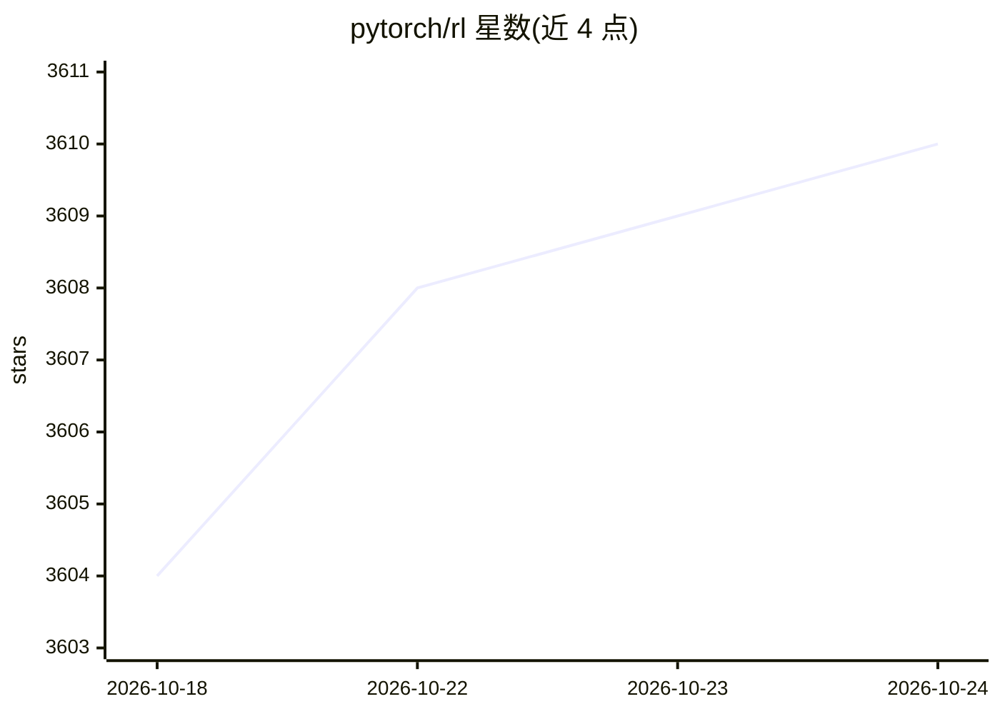

# pytorch/rl

⭐ 3,610 · Python · MIT · 推送 2026-10-23 · [GitHub](https://github.com/pytorch/rl) · [官网](https://pytorch.org/rl) · 组织维护

**PyTorch 原生的模块化强化学习工具库，供研究与机器人控制**

TorchRL 是基于 PyTorch 的强化学习、决策、机器人与仿真工具库：以 TensorDict 作为贯穿训练循环的统一数据容器，将环境、策略、replay buffer、collector、损失模块等做成可互换的独立组件。覆盖单智能体/多智能体（MAPPO/IPPO/QMIX）、model-based（DreamerV3）、模仿学习、离线 RL 及 LLM 后训练实验（GRPO/SFT，含 Hugging Face/vLLM/SGLang 集成点）。以 pip 包发布，同时含 nightly 版本。面向 RL 研究者与机器人/控制方向开发者，代码可从本地原型扩展到分布式与 torch.compile 编译执行。

## 筛选速览

| 维度 | 判定 | 备注 |
|---|---|---|
| AI 角色 | `ai-native` | 本体是模型或模型工具 |
| 许可风险 | `permissive` | MIT |
| 部署形态 | `library` | 以包/库形式分发 |
| 模型依赖 | — | README 未给出锁定关系 |
| 硬件要求 | — | 无带数字的原话,不猜 |
| 安装摩擦 | `medium` | 含编译或系统依赖之一 |
| 成熟度 | — | 结构信号不足 |

## 能力要点

- TensorDict 统一数据模型贯穿环境、collector、replay buffer 与损失
- PPO/SAC/DQN/DreamerV3/MAPPO 等大量算法目标与 SOTA 实现入口
- 单进程/多进程/异步/分布式 collector 与 memmap、CUDA-aware replay buffer
- LLM 后训练栈：GRPO/SFT 目标、vLLM/SGLang 集成点与工具调用 transform

## 适用场景

- 搭建从原型到分布式的 RL 训练管线
- 做多智能体、model-based 或模仿学习研究实验
- 接入 MuJoCo/Gymnasium/Isaac Lab 等环境做机器人与控制任务
- 跑 LLM 的 GRPO/SFT 后训练实验

## 场景标签

`强化学习` · 领域:训练与推理

## 证据(README 行号)

> L21: TorchRL is a PyTorch-native toolkit for reinforcement learning, decision making,
> L23: narrow benchmark suite: it is a collection of composable pieces for building RL

## 星数曲线

2026-10-18 3,604 → 2026-10-24 3,610（+6）

---
*卡片 v1 · prompt 1.4 · 生成 2026-10-20 · 置信度 high · 依据 README sha `e77f83022225` · [字段定义](../../DATASET.md)*
