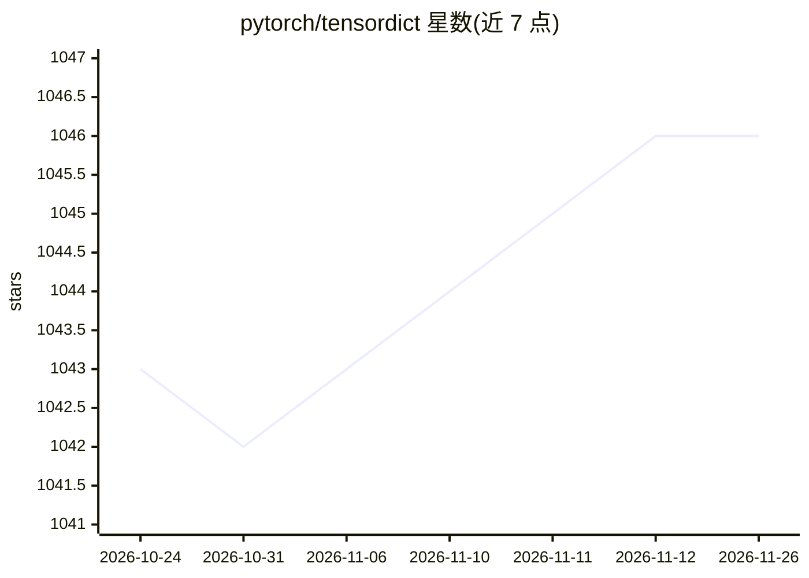

# pytorch/tensordict

⭐ 1,046 · Python · MIT · 推送 2026-11-25 · [GitHub](https://github.com/pytorch/tensordict) · [官网](https://docs.pytorch.org/tensordict) · 组织维护

**PyTorch 张量组容器库：像单个张量一样批量操作成组张量**

TensorDict 将成组共享批大小的 torch.Tensor（如训练批次、粒子系统、图批次）收纳为单一对象，索引、重塑、堆叠、.to(device)、保存等操作一次性作用于全部张量，且兼容 torch.compile/vmap/export；TensorClass 提供类型化、可批处理、可编译的 dataclass 写法。支持数据集落盘后按样本读取、模块读写命名条目、导出 numpy/pandas/h5/zarr 等格式。被 TorchRL、verl、PhysicsNeMo 等项目使用，由 PyTorch 组织维护，2022 年以来发布 40+ 版本，API 尚处 pre-1.0。

## 筛选速览

| 维度 | 判定 | 备注 |
|---|---|---|
| AI 角色 | `ai-ecosystem` | LLM/agent 周边工具 |
| 许可风险 | `permissive` | MIT |
| 部署形态 | `library` | 以包/库形式分发 |
| 模型依赖 | — | README 未给出锁定关系 |
| 硬件要求 | — | 无带数字的原话,不猜 |
| 安装摩擦 | `medium` | 含编译或系统依赖之一 |
| 成熟度 | `idea` | |

## 能力要点

- 成组张量的批大小共享：索引/重塑/堆叠/迁移设备一次作用于全部张量
- 兼容 torch.compile、torch.func（vmap/grad）与 torch.export
- TensorClass：类型化批处理 dataclass，方法可在单条目或任意批次上运行
- to_numpy/pandas/h5/zarr 导出与落盘数据集的单样本读取

## 适用场景

- 管理强化学习训练中的批次、轨迹与嵌套观测数据
- 让同一份模型/方法代码在单样本与批量输入上运行
- 将大规模数据集保存到磁盘后按样本懒加载

## 场景标签

 · 领域:深度学习基础设施/数据结构库

## 证据(README 行号)

> L9: PyTorch code that handles groups of tensors, such as a training batch, a
> L63: Pure Python, for Python 3.10+ and PyTorch 2.11+. Nightly builds and extras:
> L134: |Who maintains it?|The PyTorch organization, with 40+ releases since 2022 (release notes).|

## 星数曲线

2026-10-24 1,043 → 2026-11-26 1,046（+3）

---
*卡片 v1 · prompt 1.4 · 生成 2026-11-24 · 置信度 high · 依据 README sha `a2ce931d2896` · [字段定义](../../DATASET.md)*
