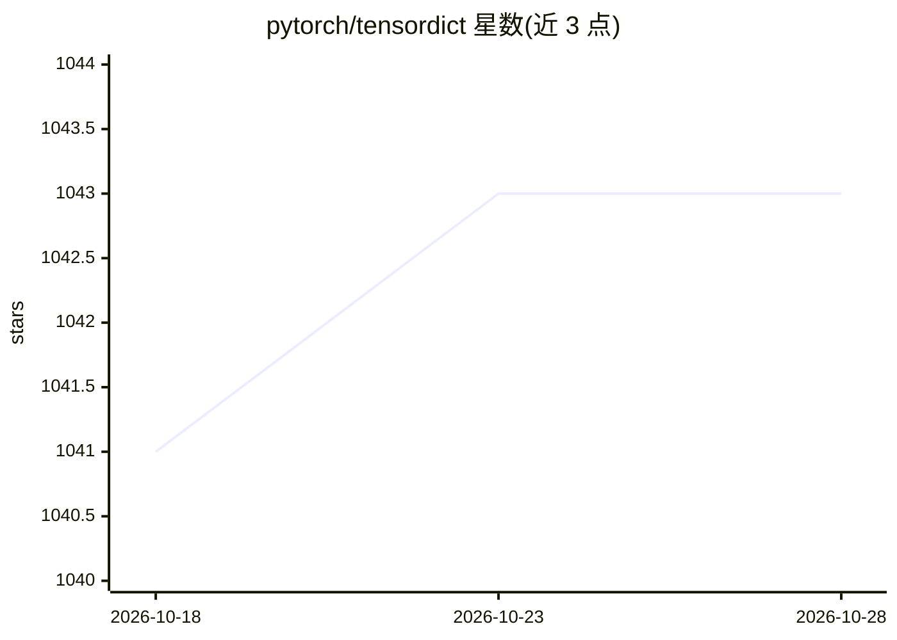

# pytorch/tensordict

⭐ 1,043 · Python · MIT · 推送 2026-10-28 · [GitHub](https://github.com/pytorch/tensordict) · [官网](https://docs.pytorch.org/tensordict) · 组织维护

**PyTorch 张量字典容器：像操作单个张量一样操作一组张量**

TensorDict 是一个行为类似单个张量的 dict[str, torch.Tensor] 容器：持有共享前导维度的张量组，索引、重塑、堆叠、.to(device)、保存与 torch.compile 可一次性作用于全部张量；TensorClass 以带类型字段和方法的类提供同样能力。支持 lazy_stack 免填充堆叠、磁盘数据集单样本读取、TensorDictModule、torch.vmap 集成，并可导出 numpy/pandas/h5/zarr。纯 Python 实现，要求 Python 3.10+ 与 PyTorch 2.11+，由 PyTorch 组织维护，2,000+ 仓库依赖它，pre-1.0 API。

## 筛选速览

| 维度 | 判定 | 备注 |
|---|---|---|
| AI 角色 | `ai-ecosystem` | LLM/agent 周边工具 |
| 许可风险 | `permissive` | MIT |
| 部署形态 | `library` | 以包/库形式分发 |
| 模型依赖 | — | README 未给出锁定关系 |
| 硬件要求 | — | 无带数字的原话,不猜 |
| 安装摩擦 | `medium` | 含编译或系统依赖之一 |
| 成熟度 | `idea` | |

## 能力要点

- 张量组整体支持索引/重塑/堆叠/.to(device)/torch.compile
- TensorClass 声明式字段与方法，单条或任意形状批量均可运行并可编译
- lazy_stack 免填充堆叠变长样本；数据集可落盘后单样本按需读取
- 导出到 numpy/pandas/h5/zarr；pytree 兼容 torch.func/torch.export

## 适用场景

- 训练批次等张量组统一搬运与变换，替代逐张量重复操作
- 强化学习/机器人/LLM 后训练中的批量数据结构管理
- 变长样本免填充堆叠与大规模数据集磁盘存储

## 场景标签

 · 领域:深度学习/数据结构库

## 证据(README 行号)

> L3: **A `dict[str, torch.Tensor]` that behaves like one tensor.**
> L11: every tensor, and nested dicts need recursion. A TensorDict holds the group as
> L47: Pure Python, for Python 3.10+ and PyTorch 2.11+. Nightly builds and extras:

## 星数曲线

2026-10-18 1,041 → 2026-10-28 1,043（+2）

---
*卡片 v1 · prompt 1.4 · 生成 2026-10-21 · 置信度 high · 依据 README sha `6fd79b8cb769` · [字段定义](../../DATASET.md)*
