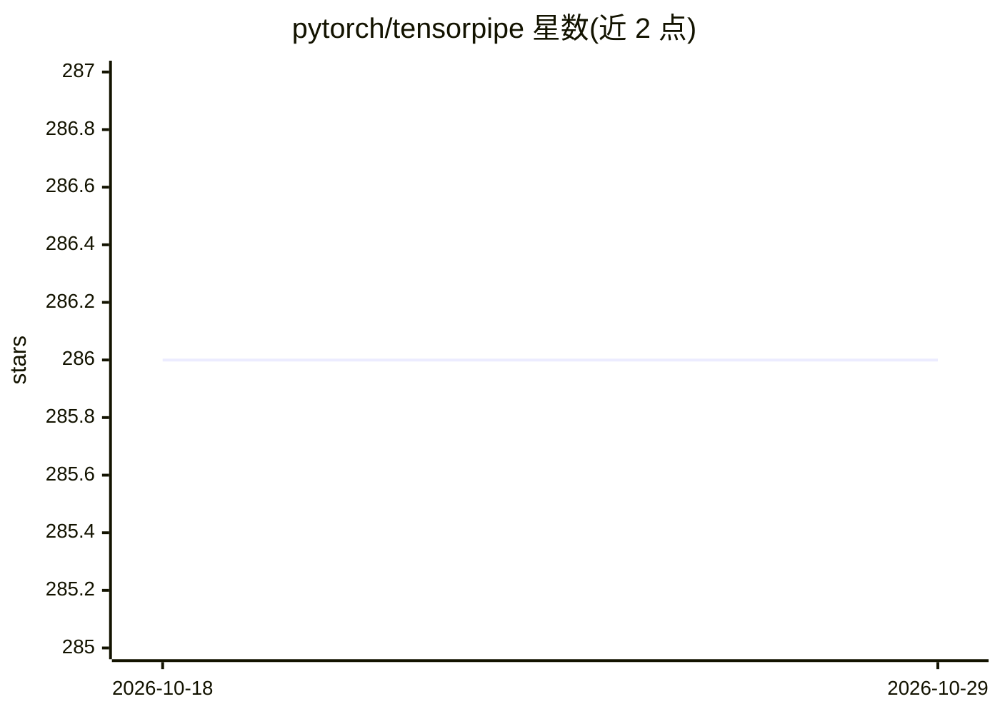

# pytorch/tensorpipe

⭐ 286 · C++ · NOASSERTION · 推送 2025-12-17 · [GitHub](https://github.com/pytorch/tensorpipe) · 组织维护

**面向张量的进程间点对点通信库，为机器学习传输富对象**

PyTorch 组织下的 C++ 库，提供进程间传输包含张量的结构化消息的通道（Context/Listener/Pipe/Message 四类接口），按场景与硬件自动协商选择后端传输方式（如 CUDA 设备间拷贝、NVLink、共享内存环形缓冲、TCP 多路复用）。消息由 CPU 上的核心载荷与任意设备上的张量列表组成，读写为非阻塞回调式，回调在 per-context 单线程按序执行，并支持背压传播。以源码 cmake+ninja 编译安装，BSD 许可。项目自 2025-12 起处于维护模式，官方指向 torchcomms 与 monarch 作为替代。

## 筛选速览

| 维度 | 判定 | 备注 |
|---|---|---|
| AI 角色 | `ai-ecosystem` | LLM/agent 周边工具 |
| 许可风险 | `none` | NOASSERTION |
| 部署形态 | `None` |  |
| 模型依赖 | — | README 未给出锁定关系 |
| 硬件要求 | — | 无带数字的原话,不猜 |
| 安装摩擦 | `high` | 编译与系统依赖俱全 |
| 成熟度 | — | 结构信号不足 |

## 能力要点

- Context/Listener/Pipe/Message 四类核心接口传输结构化消息
- 传输（transports）与通道（channels）两类后端，建立时自动协商选择
- 支持 CUDA 设备间拷贝、NVLink、共享内存环形缓冲、多 TCP 多路复用等后端
- 非阻塞异步读写、回调按序执行、支持背压传播

## 适用场景

- 在分布式机器学习组件间传输包含 GPU 张量的消息
- 同机或跨机进程间通信并按硬件选择传输介质
- 需要用户自实现特定后端的系统集成

## 场景标签

 · 领域:机器学习基础设施/分布式通信

## 证据(README 行号)

> L3: The TensorPipe project provides a tensor-aware channel to transfer rich objects
> L5: contained therein (e.g., CUDA device-to-device copy).
> L118: TensorPipe aims to be "backend-agnostic": it doesn't want to be restricted to a

## 星数曲线

2026-10-18 286 → 2026-10-29 286（+0）

---
*卡片 v1 · prompt 1.4 · 生成 2026-10-22 · 置信度 high · 依据 README sha `8bb90c5161cc` · [字段定义](../../DATASET.md)*
