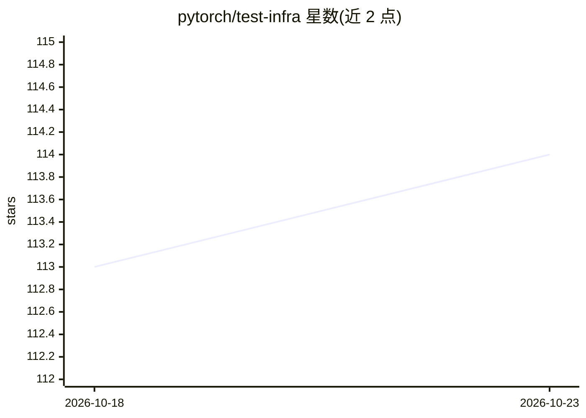

# pytorch/test-infra

⭐ 114 · TypeScript · NOASSERTION · 推送 2026-10-22 · [GitHub](https://github.com/pytorch/test-infra) · [官网](https://hud.pytorch.org/) · 组织维护

**支撑 PyTorch CI/CD 系统的测试基础设施代码集合**

PyTorch 组织的测试基础设施仓库：包含追踪禁用测试与慢测试的逻辑、CI 任务 HUD/仪表盘（hud.pytorch.org）、AWS 上运行的基础设施、若干网站以及 linter 等开发工具。仓库以 git clone --recursive 方式获取源码，本地运行 HUD 需参考 torchci 目录的 README，lint 使用 lintrunner，torchci 还依赖 yarn。采用 BSD 许可证。

## 筛选速览

| 维度 | 判定 | 备注 |
|---|---|---|
| AI 角色 | `ai-ecosystem` | LLM/agent 周边工具 |
| 许可风险 | `none` | NOASSERTION |
| 部署形态 | `None` |  |
| 模型依赖 | — | README 未给出锁定关系 |
| 硬件要求 | — | 无带数字的原话,不猜 |
| 安装摩擦 | `low` | 无编译、无系统依赖或容器化 |
| 成熟度 | — | 结构信号不足 |

## 能力要点

- 追踪禁用测试与慢测试的逻辑
- 持续集成任务 HUD/仪表盘（hud.pytorch.org）
- AWS 基础设施与多个受支持的网站
- 基于 lintrunner 的 lint 工具

## 适用场景

- 了解 PyTorch CI/CD 系统的构成
- 本地运行或开发 PyTorch CI HUD 仪表盘
- 为 PyTorch 测试基础设施贡献代码

## 场景标签

 · 领域:开发基础设施/CI-CD

## 证据(README 行号)

> L3: The PyTorch TestInfra project is collection of infrastructure components that are
> L4: supporting the PyTorch CI/CD system. It also contains various PyTorch development tools

## 星数曲线

2026-10-18 113 → 2026-10-23 114（+1）

---
*卡片 v1 · prompt 1.4 · 生成 2026-10-23 · 置信度 mid · 依据 README sha `261c188ba210` · [字段定义](../../DATASET.md)*
