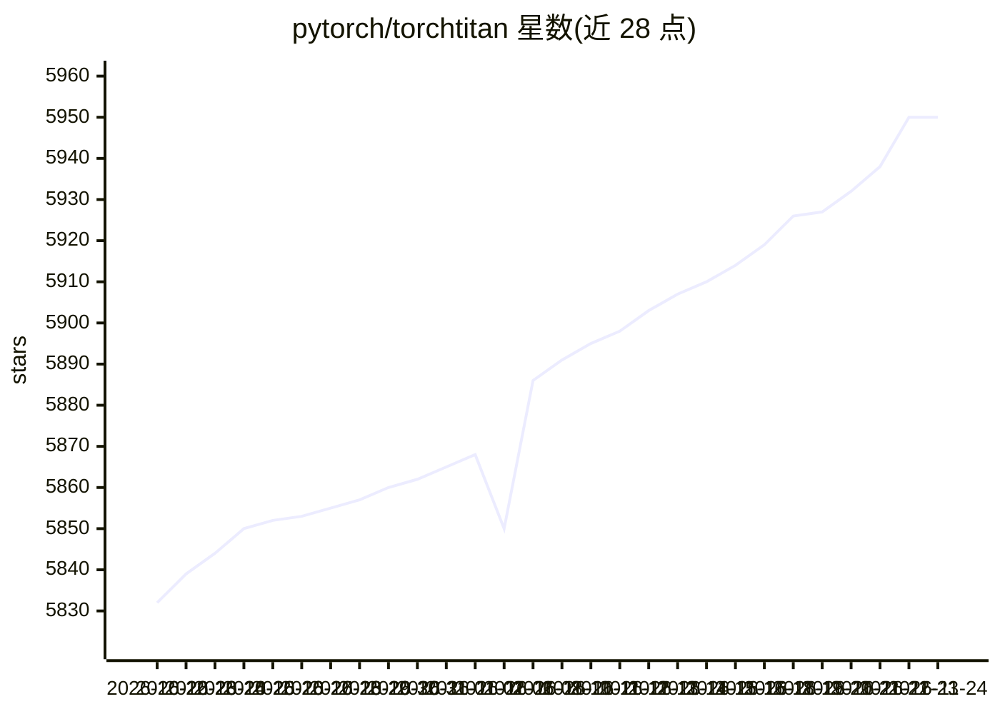

# pytorch/torchtitan

⭐ 5,966 · Python · BSD-3-Clause · 推送 2026-11-24 · [GitHub](https://github.com/pytorch/torchtitan) · 组织维护

**面向开发者的 PyTorch 原生大规模生成式 AI 模型训练平台**

torchtitan 是 PyTorch 原生的大规模训练实现，覆盖预训练、监督微调到强化学习全流程，通过 DeviceMesh 与 DTensor 将 FSDP2、张量、流水线、上下文与专家并行组合成 N-D 布局，无需改写模型。以 Python recipe 形式组织训练配置，提供 TensorBoard/W&B 指标、分布式检查点、HF safetensors 互转、SLurm 多节点脚本。要求 Python 3.11+ 与 PyTorch nightly；稳定版已发布 v0.2.0，并报告最高 512 GPU 的性能验证。

## 筛选速览

| 维度 | 判定 | 备注 |
|---|---|---|
| AI 角色 | `ai-ecosystem` | LLM/agent 周边工具 |
| 许可风险 | `permissive` | BSD-3-Clause |
| 部署形态 | `library` | 以包/库形式分发 |
| 模型依赖 | local-ok | 支持本地模型 |
| 硬件要求 | — | 无带数字的原话,不猜 |
| 安装摩擦 | `medium` | 含编译或系统依赖之一 |
| 成熟度 | `idea` | |

## 能力要点

- 可组合并行：FSDP2/TP/PP/CP/EP 通过 DeviceMesh 与 DTensor 组合
- TitanRL 在训练器与 vLLM 生成间复用同一模型定义，支持 bitwise 一致的 batch-invariant 模式
- 支持 Llama、Qwen3、DeepSeek V3、gpt-oss、Kimi、FLUX 等模型及 MXFP8/NVFP4 低精度训练
- 分布式检查点、HF safetensors 直接读写与 SLurm 多节点训练脚本

## 适用场景

- 在多 GPU/多节点集群上预训练大语言模型
- 对聊天数据做 SFT 或 LoRA 微调
- 用 GRPO/DAPO 做强化学习后训练
- 在单 GPU 上用 fake-backend 干跑验证大规模并行布局

## 场景标签

`模型训练` `微调` `强化学习` · 领域:训练与推理

## 证据(README 行号)

> L14: `torchtitan` is a clean-room, PyTorch-native implementation of large-scale
> L16: supervised fine-tuning to reinforcement learning, composing FSDP, tensor,
> L23: - **Pretraining to RL in one stack.** TitanRL runs the

## 星数曲线

2026-10-22 5,832 → 2026-11-24 5,950（+118）

---
*卡片 v1 · prompt 1.4 · 生成 2026-11-22 · 置信度 high · 依据 README sha `5c0e7bba97a2` · [字段定义](../../DATASET.md)*
