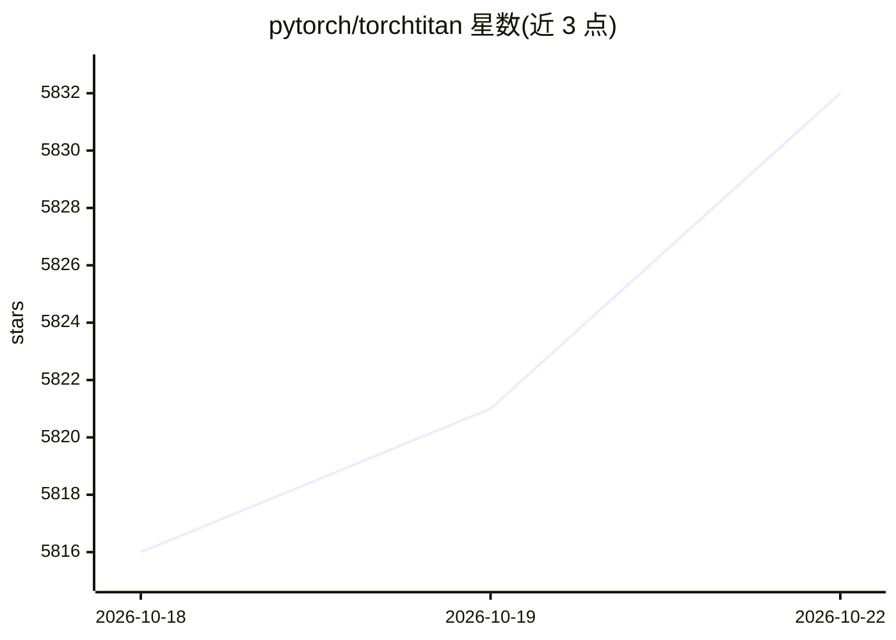

# pytorch/torchtitan

⭐ 5,839 · Python · BSD-3-Clause · 推送 2026-10-22 · [GitHub](https://github.com/pytorch/torchtitan) · 组织维护

**PyTorch 原生的大模型预训练/后训练/RL 平台**

面向大规模生成式 AI 训练的 PyTorch 原生实现：单一可读代码库覆盖从预训练、SFT 到强化学习（TitanRL）的流程，通过 DeviceMesh/DTensor 组合 FSDP2、张量/流水线/上下文/专家并行，无需改写模型。以 Python recipe 配置运行，支持 Llama、Qwen、DeepSeek、gpt-oss、FLUX 等模型及 MXFP8/NVFP4 低精度训练。支持多节点 Slurm 提交与 HF safetensors 检查点互转；建议使用 PyTorch nightly，多数特性依赖 GPU 环境。

## 筛选速览

| 维度 | 判定 | 备注 |
|---|---|---|
| AI 角色 | `ai-ecosystem` | LLM/agent 周边工具 |
| 许可风险 | `permissive` | BSD-3-Clause |
| 部署形态 | `library` | 以包/库形式分发 |
| 模型依赖 | local-ok | 支持本地模型 |
| 硬件要求 | — | 无带数字的原话,不猜 |
| 安装摩擦 | `medium` | 含编译或系统依赖之一 |
| 成熟度 | — | 结构信号不足 |

## 能力要点

- FSDP2/TP/PP/CP/EP 可组合并行，无需改写模型
- 预训练、SFT 到 RL（GRPO/DAPO）共用一套模型定义与内核
- MXFP8/NVFP4 低精度训练、CUDA graphs、Dist-MoE
- Python recipe 式配置与分布式检查点、HF safetensors 互转

## 适用场景

- 在多 GPU 集群上预训练或微调开源大模型
- 在训练与 vLLM 生成间复用模型定义做 RL 后训练
- 研究并调试大规模并行训练技术

## 场景标签

`模型训练` `微调` `强化学习` · 领域:训练与推理

## 证据(README 行号)

> L14: `torchtitan` is a clean-room, PyTorch-native implementation of large-scale
> L16: supervised fine-tuning to reinforcement learning, composing FSDP, tensor,
> L23: - **Pretraining to RL in one stack.** TitanRL runs the

## 星数曲线

2026-10-18 5,816 → 2026-10-22 5,832（+16）

---
*卡片 v1 · prompt 1.4 · 生成 2026-10-20 · 置信度 high · 依据 README sha `fedf6ca611c9` · [字段定义](../../DATASET.md)*
