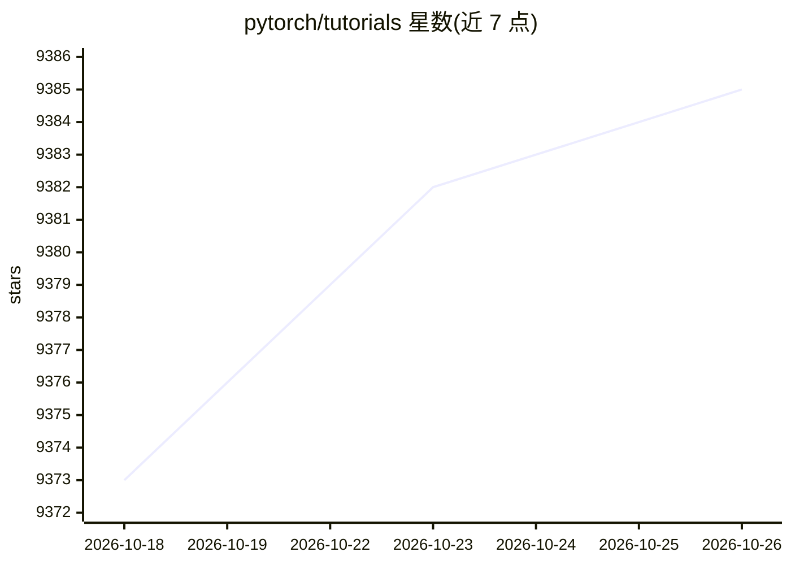

# pytorch/tutorials

⭐ 9,385 · Python · BSD-3-Clause · 推送 2026-10-21 · [GitHub](https://github.com/pytorch/tutorials) · [官网](https://pytorch.org/tutorials/) · 组织维护

**PyTorch 官方教程仓库：以 Sphinx 文档形式呈现的深度学习教程集**

PyTorch 官方维护的教程仓库，所有教程以 Sphinx 风格文档发布在 pytorch.org/tutorials，内容通过可执行 Python 文件生成文档。面向使用 PyTorch 的开发者和学习者，覆盖问题反馈、贡献指南、本地构建等流程。本地构建完整文档需要 GPU（约 60-120 分钟），无 GPU 时可用 make html-noplot 跳过计算生成基础 HTML；支持 GALLERY_PATTERN 正则筛选构建单个教程，并提供 pyspelling 拼写检查。采用 BSD 许可。

## 筛选速览

| 维度 | 判定 | 备注 |
|---|---|---|
| AI 角色 | `ai-knowledge` | 知识聚合/清单类 |
| 许可风险 | `permissive` | BSD-3-Clause |
| 部署形态 | `library` | 以包/库形式分发 |
| 模型依赖 | — | README 未给出锁定关系 |
| 硬件要求 | — | 无带数字的原话,不猜 |
| 安装摩擦 | `low` | 无编译、无系统依赖或容器化 |
| 成熟度 | — | 结构信号不足 |

## 能力要点

- 教程以可执行 Python 文件组织，经 Sphinx 生成文档
- GALLERY_PATTERN 支持按正则构建单个教程
- 提供 pyspelling 拼写检查（python 文件与 beginner/ 目录的 .rst）
- BSD 许可，由 PyTorch 官方团队维护

## 适用场景

- 学习 PyTorch 各类深度学习教程
- 本地构建或预览教程文档用于贡献修改
- 提交教程的功能请求或过时内容报告

## 场景标签

`教程课程` · 领域:学习与行业

## 证据(README 行号)

> L1: # PyTorch Tutorials
> L3: All the tutorials are now presented as sphinx style documentation at:

## 星数曲线

2026-10-18 9,373 → 2026-10-26 9,385（+12）

---
*卡片 v1 · prompt 1.4 · 生成 2026-10-20 · 置信度 mid · 依据 README sha `f9b6384ebcdf` · [字段定义](../../DATASET.md)*
