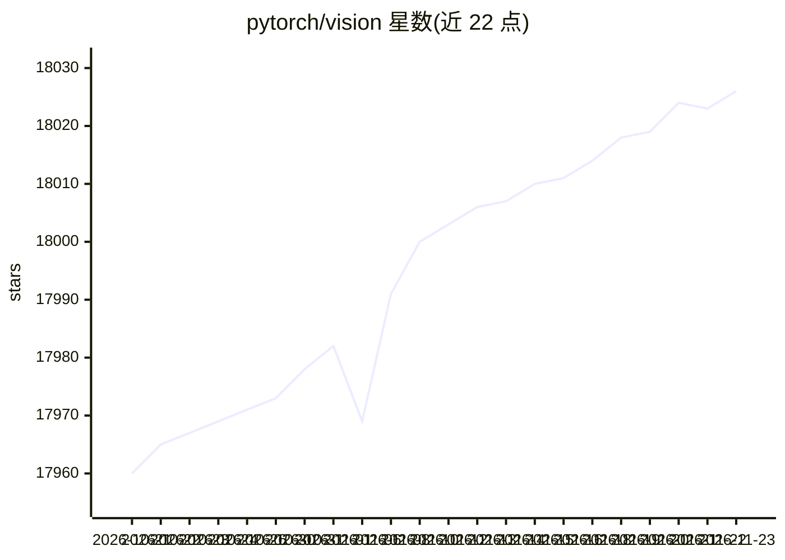

# pytorch/vision

⭐ 18,026 · Python · BSD-3-Clause · 推送 2026-11-22 · [GitHub](https://github.com/pytorch/vision) · [官网](https://pytorch.org/vision) · 组织维护

**为 PyTorch 用户提供计算机视觉数据集、变换与模型架构的库**

torchvision 是 PyTorch 生态下的计算机视觉库，由三部分组成：常用公开数据集的下载与准备、常见图像变换（transforms）、以及用于计算机视觉的模型架构（含预训练权重）。安装需通过 pytorch.org 官方页面获取与 torch 版本对应的包，也可从源码构建；README 提供各版本与 Python 版本的对应表。数据集由库代为下载，版权责任由使用者自行判断；部分预训练模型（如 SWAG）沿用 CC-BY-NC 4.0 许可。

## 筛选速览

| 维度 | 判定 | 备注 |
|---|---|---|
| AI 角色 | `ai-native` | 本体是模型或模型工具 |
| 许可风险 | `permissive` | BSD-3-Clause |
| 部署形态 | `None` |  |
| 模型依赖 | — | README 未给出锁定关系 |
| 硬件要求 | — | 无带数字的原话,不猜 |
| 安装摩擦 | `low` | 无编译、无系统依赖或容器化 |
| 成熟度 | — | 结构信号不足 |

## 动量与使用信号

- 维护:`active` — 距上次 push 0.9 天,年发版 8,446 位贡献者
- 涨星:近 1 天 **+1**(自 20261016 起算)

## 能力要点

- 提供常用计算机视觉数据集的下载与准备
- 提供常见图像变换（transforms）
- 提供模型架构与预训练权重
- 支持 torch tensors 与 PIL（Pillow/Pillow-SIMD）两种图像后端

## 适用场景

- 在 PyTorch 中加载 ImageNet 等公开视觉数据集
- 对图像做标准化、裁剪等预处理变换
- 使用预训练视觉模型进行迁移学习

## 场景标签

`图像视频处理` `模型训练` · 领域:感知与多模态

## 证据(README 行号)

> L6: The torchvision package consists of popular datasets, model architectures, and common image transformations for comp
> L7: vision.

## 星数曲线

2026-10-21 17,960 → 2026-11-23 18,026（+66）

---
*卡片 v1 · prompt 1.4 · 生成 2026-11-22 · 置信度 high · 依据 README sha `617979eec856` · [字段定义](../../DATASET.md)*
