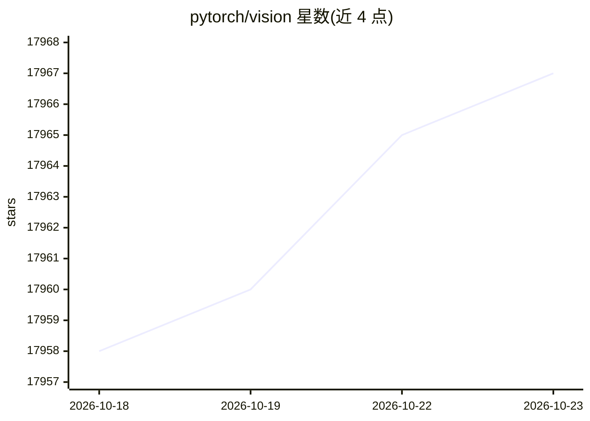

# pytorch/vision

⭐ 17,967 · Python · BSD-3-Clause · 推送 2026-10-22 · [GitHub](https://github.com/pytorch/vision) · [官网](https://pytorch.org/vision) · 组织维护

**给 CV 开发者提供数据集、模型架构与图像变换的 PyTorch 库**

torchvision 是 PyTorch 官方的计算机视觉库，提供三部分内容：常用公开数据集（下载与预处理工具）、模型架构（含预训练权重）以及常见图像变换。安装需与 torch 版本配套，README 给出二者与 Python 版本的对应表；支持 torch tensors 与 PIL（含 Pillow-SIMD）两种图像后端。README 声明库本身不托管数据集，数据集与预训练模型可能附带各自的许可条款（如 SWAG 模型为 CC-BY-NC 4.0），使用许可由用户自行判断。

## 筛选速览

| 维度 | 判定 | 备注 |
|---|---|---|
| AI 角色 | `ai-ecosystem` | LLM/agent 周边工具 |
| 许可风险 | `permissive` | BSD-3-Clause |
| 部署形态 | `None` |  |
| 模型依赖 | — | README 未给出锁定关系 |
| 硬件要求 | — | 无带数字的原话,不猜 |
| 安装摩擦 | `low` | 无编译、无系统依赖或容器化 |
| 成熟度 | — | 结构信号不足 |

## 动量与使用信号

- 维护:`active` — 距上次 push 0.9 天,年发版 8,446 位贡献者
- 涨星:近 1 天 **+1**(自 20261016 起算)

## 能力要点

- 提供公开数据集、模型架构与常见图像变换
- 与 torch 版本一一配套（版本对应表）
- 支持 torch tensors 与 PIL/Pillow-SIMD 图像后端
- 部分预训练模型（SWAG）使用 CC-BY-NC 4.0 许可

## 适用场景

- 在 PyTorch 中加载和预处理计算机视觉数据集
- 使用预训练视觉模型做训练或推理
- 为训练流水线构建图像变换

## 场景标签

 · 领域:机器学习/计算机视觉

## 证据(README 行号)

> L6: The torchvision package consists of popular datasets, model architectures, and common image transformations for comp
> L7: vision.
> L60: Torchvision currently supports the following image backends:

## 星数曲线

2026-10-18 17,958 → 2026-10-23 17,967（+9）

---
*卡片 v1 · prompt 1.4 · 生成 2026-10-18 · 置信度 high · 依据 README sha `406c42b8bd8b` · [字段定义](../../DATASET.md)*
