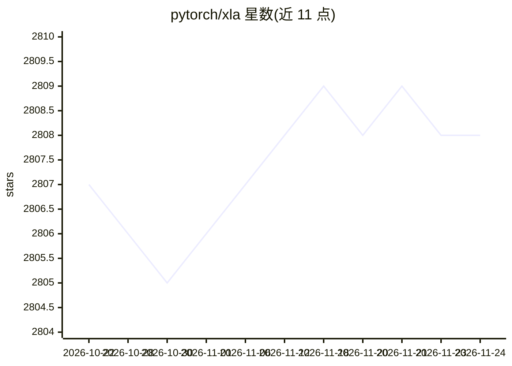

# pytorch/xla

⭐ 2,808 · C++ · NOASSERTION · 推送 2026-10-20 · [GitHub](https://github.com/pytorch/xla) · [官网](https://pytorch.org/xla) · 组织维护

**让 PyTorch 在 XLA 设备（Google TPU）上运行的 Python 包**

PyTorch/XLA 是一个 Python 包，通过 XLA 深度学习编译器连接 PyTorch 框架与 Cloud TPU。用户只需对现有训练循环做少量导入改动即可将模型迁移到 TPU 上训练，支持单进程、多进程与 SPMD 三种模式。提供 PyPI wheel、nightly wheel 与 Docker 镜像多种分发方式，并附 Kaggle 入门 notebook、性能调试与故障排查文档。README 明确声明该项目已弃用，由 TorchTPU 取代，仓库将于 2026 年 11 月 15 日归档。

## 筛选速览

| 维度 | 判定 | 备注 |
|---|---|---|
| AI 角色 | `ai-ecosystem` | LLM/agent 周边工具 |
| 许可风险 | `none` | NOASSERTION |
| 部署形态 | `desktop` | 安装包/桌面程序 |
| 模型依赖 | — | README 未给出锁定关系 |
| 硬件要求 | — | 无带数字的原话,不猜 |
| 安装摩擦 | `low` | 无编译、无系统依赖或容器化 |
| 成熟度 | — | 结构信号不足 |

## 能力要点

- 通过 XLA 编译器连接 PyTorch 与 Cloud TPU
- 支持单进程、多进程与 SPMD 多 TPU 模式
- 提供 PyPI 稳定/nightly wheel 与 Docker 镜像
- 提供 C++11 ABI 构建、AMP/DDP/FSDP/SPMD 等文档

## 适用场景

- 将现有 PyTorch 训练循环迁移到 Cloud TPU 运行
- 在 Kaggle 免费 TPU VM 上试用 PyTorch
- 在 TPU Pod 上进行多进程/SPMD 分布式训练

## 场景标签

`模型训练` · 领域:训练与推理

## 证据(README 行号)

> L13: PyTorch/XLA is a Python package that uses the [XLA deep learning
> L14: compiler](https://www.tensorflow.org/xla) to connect the [PyTorch deep learning
> L15: framework](https://pytorch.org/) and [Cloud
> L156: XLA devices (TPU, CPU and...).

## 星数曲线

2026-10-22 2,807 → 2026-11-24 2,808（+1）

---
*卡片 v1 · prompt 1.4 · 生成 2026-11-23 · 置信度 high · 依据 README sha `b39be28a5762` · [字段定义](../../DATASET.md)*
