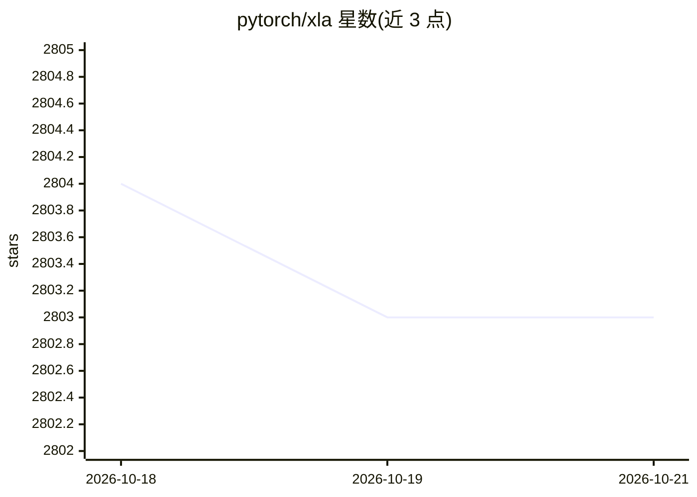

# pytorch/xla

⭐ 2,803 · C++ · NOASSERTION · 推送 2026-10-13 · [GitHub](https://github.com/pytorch/xla) · [官网](https://pytorch.org/xla) · 组织维护

**让 PyTorch 在 XLA 设备（如 Google TPU）上运行的编译桥接包**

Python 包，使用 XLA 深度学习编译器连接 PyTorch 框架与 Cloud TPU：通过 import torch_xla 及少量训练循环改动，将已有 PyTorch 模型迁移到 TPU（也支持 CPU 等 XLA 设备）。提供 pip/PyPI 安装、nightly wheels、Docker 镜像，支持单进程、多进程与 SPMD 模式，文档覆盖 AMP/DDP/FSDP/量化等性能主题。由 Google 与 Meta 联合维护；README 声明 TorchTPU 公开后将取代 PyTorch/XLA。

## 筛选速览

| 维度 | 判定 | 备注 |
|---|---|---|
| AI 角色 | `ai-ecosystem` | LLM/agent 周边工具 |
| 许可风险 | `none` | NOASSERTION |
| 部署形态 | `desktop` | 安装包/桌面程序 |
| 模型依赖 | — | README 未给出锁定关系 |
| 硬件要求 | — | 无带数字的原话,不猜 |
| 安装摩擦 | `low` | 无编译、无系统依赖或容器化 |
| 成熟度 | — | 结构信号不足 |

## 能力要点

- 用 XLA 编译器连接 PyTorch 与 Cloud TPU/CPU 等 XLA 设备
- 少量代码改动即可迁移已有训练循环到 TPU
- 支持单进程、多进程与 SPMD 分布式模式
- 提供 PyPI wheel、nightly 构建与 Docker 镜像

## 适用场景

- 把已有 PyTorch 训练代码迁移到 Cloud TPU 运行
- 在大规模 TPU Pod 上做分布式训练（多进程/SPMD）
- 用 Docker 镜像快速搭建 TPU 训练环境

## 场景标签

`模型训练` · 领域:训练与推理

## 证据(README 行号)

> L11: PyTorch/XLA is a Python package that uses the [XLA deep learning
> L12: compiler](https://www.tensorflow.org/xla) to connect the [PyTorch deep learning
> L13: framework](https://pytorch.org/) and [Cloud

## 星数曲线

2026-10-18 2,804 → 2026-10-21 2,803（-1）

---
*卡片 v1 · prompt 1.4 · 生成 2026-10-21 · 置信度 high · 依据 README sha `a22f9be8f9ee` · [字段定义](../../DATASET.md)*
