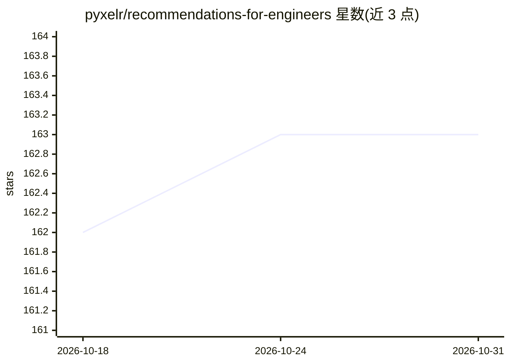

# pyxelr/recommendations-for-engineers

⭐ 163 · MIT · 推送 2026-10-13 · [GitHub](https://github.com/pyxelr/recommendations-for-engineers) · [官网](https://pawelcislo.com/recommendations/) · 个人维护

**面向工程师的学习资源推荐清单：博客、书籍、课程与工具**

个人维护的 awesome 风格推荐清单，按博客、书籍等大类组织，覆盖数据科学、编程、Python、数学、网络安全、商业、效率等领域，部分条目来自作者的波兰语博客文章。内容聚合了面向有志工程师的博客、书籍（含 AI/ML、MLOps、网络安全书目）及工具与课程推荐，并接受社区 pull request 补充条目与修复失效链接。

## 筛选速览

| 维度 | 判定 | 备注 |
|---|---|---|
| AI 角色 | `ai-knowledge` | 知识聚合/清单类 |
| 许可风险 | `permissive` | MIT |
| 部署形态 | `None` |  |
| 模型依赖 | — | README 未给出锁定关系 |
| 硬件要求 | — | 无带数字的原话,不猜 |
| 安装摩擦 | `medium` | 含编译或系统依赖之一 |
| 成熟度 | — | 结构信号不足 |

## 能力要点

- 按博客、书籍、课程、工具等类别组织条目
- 覆盖数据科学、网络安全、数学、MLOps、商业等领域
- 部分条目来自作者波兰语博客内容，支持社区 PR 补充

## 适用场景

- 查找数据科学与机器学习相关的博客和书籍
- 按领域浏览工程师学习资源推荐
- 发现网络安全与 MLOps 领域的阅读材料

## 场景标签

`精选清单` · 领域:学习与行业

## 证据(README 行号)

> L3: All of my recommendations for aspiring engineers in a single place, coming from various areas of interest. The princ
> L7: Inspired by the awesome list thing.

## 星数曲线

2026-10-18 162 → 2026-10-31 163（+1）

---
*卡片 v1 · prompt 1.4 · 生成 2026-10-22 · 置信度 high · 依据 README sha `ab8a91f686bf` · [字段定义](../../DATASET.md)*
