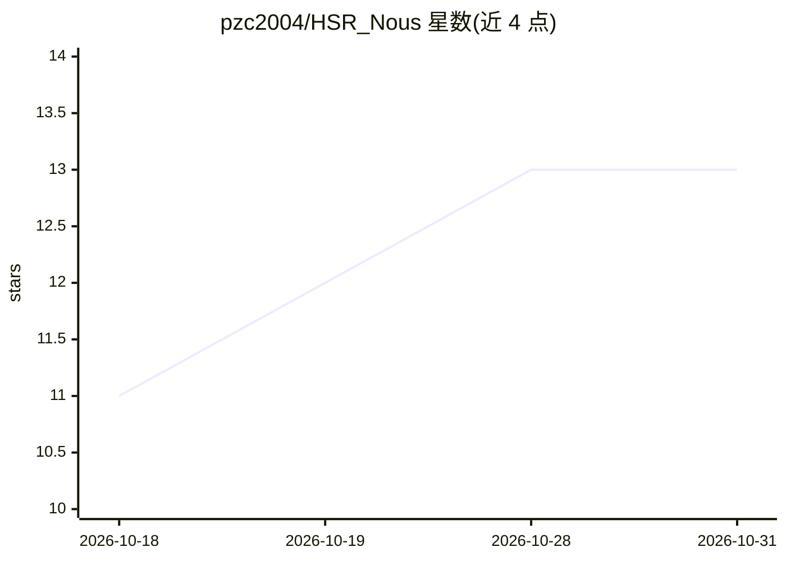

# pzc2004/HSR_Nous

⭐ 13 · Python · MIT · 推送 2026-10-22 · [GitHub](https://github.com/pzc2004/HSR_Nous) · 个人维护 · 中文 README

**《崩坏：星穹铁道》战斗模拟与配装优化的可复现实验环境**

面向《崩坏：星穹铁道》配装配队优化的研究项目：以自研确定性回合制战斗模拟器为验证器，读取 StarRailRes、Hakushin、Fandom wiki 等多源游戏数据，通过事件-响应模型与 YAML 策略描述战斗，固定随机种子输出伤害分布、生存率、能量循环等指标。上层为记忆驱动的 autoresearch agent 探索循环（假设-实验-评审-入库-迭代，开发中），LLM 用于生成结构化策略规则。MVP 限定单队伍单关卡与固定种子仿真；Agent 旧层已删除待重建。

## 筛选速览

| 维度 | 判定 | 备注 |
|---|---|---|
| AI 角色 | `ai-enhanced` | 去掉 AI 部分产品仍成立 |
| 许可风险 | `permissive` | MIT |
| 部署形态 | `library` | 以包/库形式分发 |
| 模型依赖 | — | README 未给出锁定关系 |
| 硬件要求 | — | 无带数字的原话,不猜 |
| 安装摩擦 | `low` | 无编译、无系统依赖或容器化 |
| 成熟度 | `idea` | |

## 能力要点

- 确定性状态机仿真，固定种子输出可复现（逐位一致目标）
- 实体数据三分（配置/状态/规则），新角色只改输入不动源码
- 策略用 YAML 规则+参数定义，支持参数独立调优与 LLM 生成
- 记忆驱动的探索循环：假设-实验-评审-入库-迭代两档模式

## 适用场景

- 我想系统性比较遗器、光锥、配速与队伍构成的伤害表现
- 我需要可复现的战斗实验环境来验证配装假设
- 我想让 agent 持续探索配装方案并沉淀可复核的结论

## 场景标签

`Agent 框架` · 领域:Agent 开发

## 证据(README 行号)

> L7: 本项目面向《崩坏：星穹铁道》的配装与配队优化，以自研战斗模拟器为裁判、记忆驱动的探索循环为骨架，将目标转化为可验证、可复现的决策结果——快查秒回配装结论，探索模式持续沉淀机制新知。
> L42: AI 驱动研究的共性结构是"生成 × 验证 × 循环"，**裁判（验证器）的成本决定一切**：数学有 Lean、代码有编译器、湿实验室按小时计费。本项目自带裁判——战斗模拟器就是零成本、确定性的实验台。多数配装工具只能拉表估算，我
> L111: - 模拟器直接 interpret，100% deterministic

## 星数曲线

2026-10-18 11 → 2026-10-31 13（+2）

---
*卡片 v1 · prompt 1.4 · 生成 2026-10-31 · 置信度 high · 依据 README sha `53b53172a89b` · [字段定义](../../DATASET.md)*
