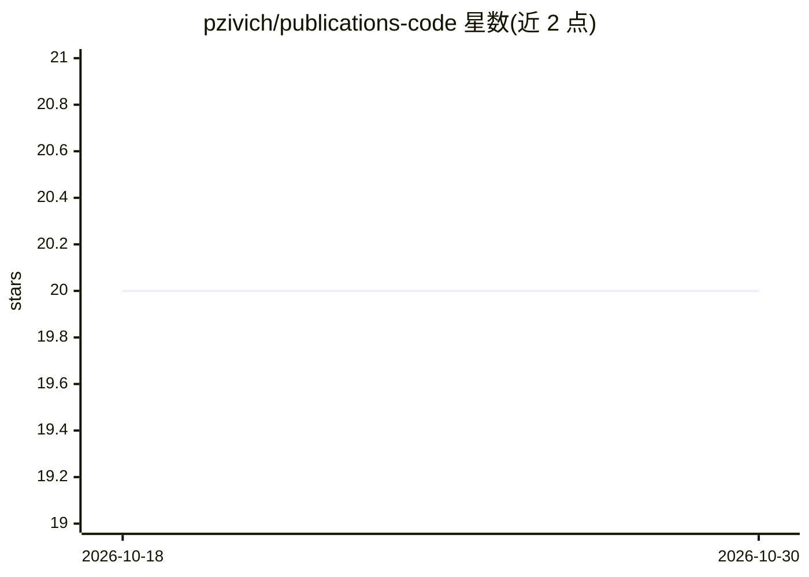

# pzivich/publications-code

⭐ 20 · Python · 推送 2026-10-26 · [GitHub](https://github.com/pzivich/publications-code) · 个人维护

**流行病学与因果推断论文配套代码合集（约30项研究）**

个人研究者（Zivich PN）公开发表论文的配套代码长期存档仓库，另通过 Zenodo DOI 持久化存储。条目按论文组织，覆盖因果推断（g-computation、TMLE、近端因果推断、估计方程）、缺失数据、合并汇总 logistic 回归、敏感性分析、SARS-CoV-2 混检策略等流行病学统计方法主题，多数论文发表于 American Journal of Epidemiology、Epidemiology、Statistics in Medicine 等期刊。README 仅列出论文清单与索引，未提供安装运行说明，代码按子目录存放。

## 筛选速览

| 维度 | 判定 | 备注 |
|---|---|---|
| AI 角色 | `ai-knowledge` | 知识聚合/清单类 |
| 许可风险 | `none` | — |
| 部署形态 | `None` |  |
| 模型依赖 | — | README 未给出锁定关系 |
| 硬件要求 | — | 无带数字的原话,不猜 |
| 安装摩擦 | `low` | 无编译、无系统依赖或容器化 |
| 成熟度 | — | 结构信号不足 |

## 能力要点

- 约 30 项论文配套代码条目，按论文名组织目录
- 同步存档于 Zenodo 并分配 DOI
- 主题覆盖因果推断、缺失数据、估计方程等流行病学统计方法

## 适用场景

- 查阅某篇流行病学/统计方法论文的配套实现代码
- 获取经 DOI 持久化引用的出版物代码存档
- 学习 g-computation、TMLE 等因果推断方法的代码实现

## 场景标签

 · 领域:流行病学/生物统计方法研究

## 证据(README 行号)

> L3: This repository is a collection of publicly available code from my publications. This repository is for
> L4: long-term storage and future reference. In addition to GitHub, all code is stored on Zenodo at the following DOI

## 星数曲线

2026-10-18 20 → 2026-10-30 20（+0）

---
*卡片 v1 · prompt 1.4 · 生成 2026-10-28 · 置信度 high · 依据 README sha `25cd2ffe51c6` · [字段定义](../../DATASET.md)*
