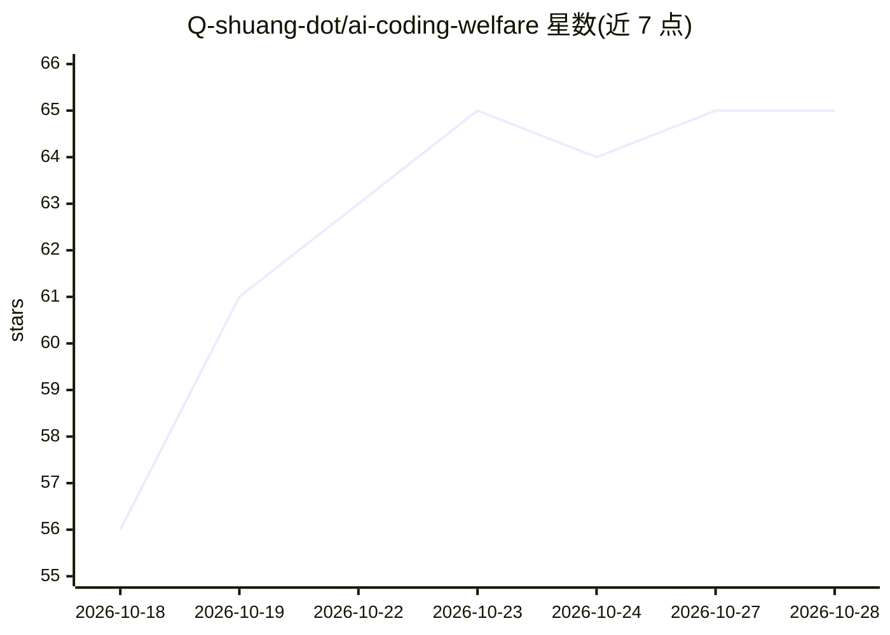

# Q-shuang-dot/ai-coding-welfare

⭐ 65 · JavaScript · MIT · 推送 2026-10-27 · [GitHub](https://github.com/Q-shuang-dot/ai-coding-welfare) · [官网](https://q-shuang-dot.github.io/ai-coding-welfare/) · 个人维护 · 中文 README

**Claude Code/Codex 免费额度公益站与中转站导航清单**

收录 12 个提供 Claude Code / Codex / Cursor 免费或签到额度的第三方公益站/中转站（AgentRouter、启源星、DoCode 等），按在线状态、首日可得额度、邀请码、兼容协议组织成表。模型价格、在线状态等由脚本抓取各站公开接口自动生成并定时更新（README 标注每 6 小时），超 48 小时无数据的站点保留快照。每站附注册要求、Base URL 环境变量配置、连通性自测命令与站点公告同步。仓库自声明只做信息聚合，不含本产品安装；提供 quickstart 脚本用于写客户端环境变量。

## 筛选速览

| 维度 | 判定 | 备注 |
|---|---|---|
| AI 角色 | `ai-knowledge` | 知识聚合/清单类 |
| 许可风险 | `permissive` | MIT |
| 部署形态 | `library` | 以包/库形式分发 |
| 模型依赖 | — | README 未给出锁定关系 |
| 硬件要求 | — | 无带数字的原话,不猜 |
| 安装摩擦 | `low` | 无编译、无系统依赖或容器化 |
| 成熟度 | — | 结构信号不足 |

## 能力要点

- 12 个福利站条目，含额度构成、兼容协议与邀请码
- 脚本自动抓取站点公开接口生成模型价格与在线状态
- 每站附 Claude Code / Codex CLI / OpenAI SDK 接入配置示例
- 提供 quickstart.sh / quickstart.ps1 一键写环境变量脚本

## 适用场景

- 想白嫖免费额度使用 Claude Code 或 Codex 时查找可用站点
- 比较各公益站的首日额度、签到机制与兼容协议
- 站点打不开时查找备用域名与镜像入口

## 场景标签

`精选清单` · 领域:学习与行业

## 证据(README 行号)

> L27: > 下面两张表都是第三方站点，本仓库只做信息聚合。
> L44: > 「首日可得」= 注册基础额度 + 本页邀请链接额度 + 当天能领的签到额度（每日重置额度池的站点按一天的池子算）；模型、价格、在线状态由脚本抓取站点公开接口自动生成，最后更新：`2026-10-23 17:06 UTC`。

## 星数曲线

2026-10-18 56 → 2026-10-28 65（+9）

---
*卡片 v1 · prompt 1.4 · 生成 2026-10-24 · 置信度 mid · 依据 README sha `c9df739f9a8e` · [字段定义](../../DATASET.md)*
