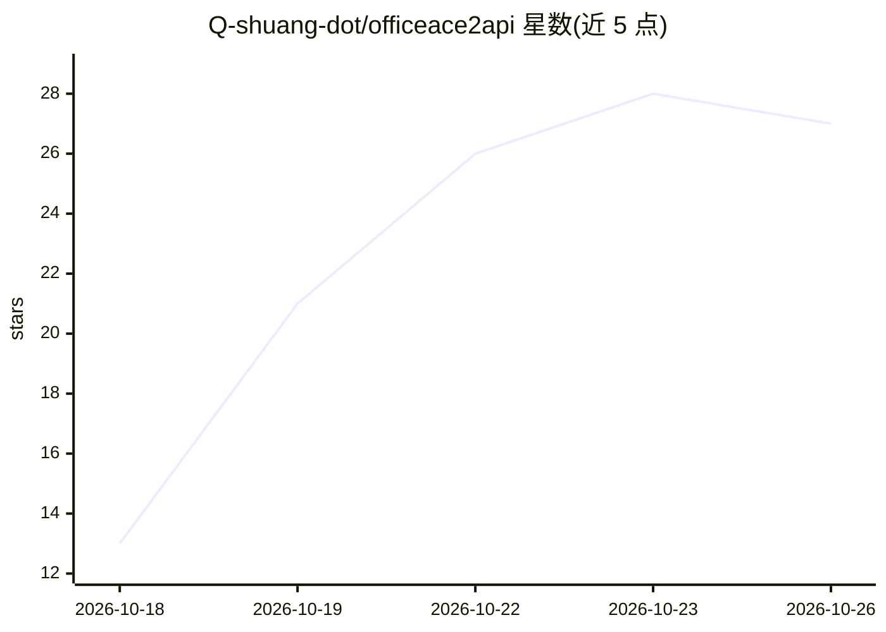

# Q-shuang-dot/officeace2api

⭐ 27 · JavaScript · MIT · 推送 2026-10-19 · [GitHub](https://github.com/Q-shuang-dot/officeace2api) · 个人维护 · 中文 README

**把模型网关反代成 OpenAI 兼容 API 的零依赖 Node 网关**

用 Node.js 内置模块实现（无 npm 依赖）的反向代理网关：将模型网关（默认华为云 OfficeAce）转换为标准 OpenAI 兼容 API（/v1/chat/completions 流式/非流式、Function Calling、reasoning_content、usage 统计），自带中文 Web 控制台管理多账号池、用量、积分与模型清单。账号通过 PKCE + 华为云回调 + DPoP 自助授权添加，或自动发现本机 OfficeAce 桌面端已登录账号；支持凭据导出迁移、自动续期、批量注册与 Windows 开机自启。面向 Windows 用户为主（启动脚本为批处理），也支持配置为通用 OpenAI 兼容上游反代。

## 筛选速览

| 维度 | 判定 | 备注 |
|---|---|---|
| AI 角色 | `ai-ecosystem` | LLM/agent 周边工具 |
| 许可风险 | `permissive` | MIT |
| 部署形态 | `desktop` | 安装包/桌面程序 |
| 模型依赖 | — | README 未给出锁定关系 |
| 硬件要求 | — | 无带数字的原话,不猜 |
| 安装摩擦 | `low` | 无编译、无系统依赖或容器化 |
| 成熟度 | — | 结构信号不足 |

## 能力要点

- 零 npm 依赖，仅用 Node.js 内置模块
- 多账号池：轮询、限流冷却、积分熔断、凭据自动续期
- 自带中文控制台：账号池/用量/积分/模型/日志/配置管理
- 支持任意可填 Base URL 的 OpenAI 兼容客户端接入

## 适用场景

- 把模型网关接入 Cherry Studio、Cline、Dify 等 OpenAI 兼容客户端
- 多账号统一管理与积分监控，余额耗尽自动跳过
- 换电脑时一键导出/导入全部账号凭证

## 场景标签

`模型网关` · 领域:Agent 开发

## 证据(README 行号)

> L7: 把一个模型网关反代成一整套标准 **OpenAI 兼容 API**，并自带一个中文控制台。
> L29: 任何能填 Base URL 的客户端都能接：Cherry Studio、NextChat、LobeChat、Cline、Roo Code、
> L30: Continue、Cursor、Dify、沉浸式翻译、OpenAI SDK……

## 星数曲线

2026-10-18 13 → 2026-10-26 27（+14）

---
*卡片 v1 · prompt 1.4 · 生成 2026-10-26 · 置信度 mid · 依据 README sha `11445b20df9e` · [字段定义](../../DATASET.md)*
