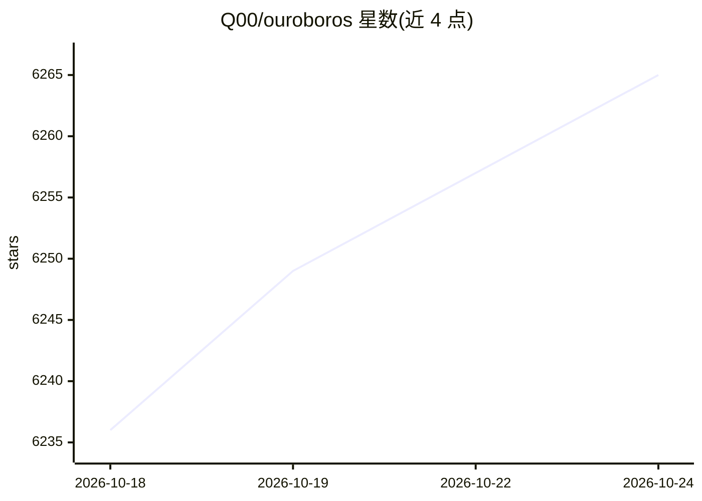

# Q00/ouroboros

⭐ 6,265 · Python · MIT · 推送 2026-10-23 · [GitHub](https://github.com/Q00/ouroboros) · [官网](https://ouroboros.page/) · 个人维护 · 中文 README

**面向 AI 编程 agent 的本地工作流运行时（Agent OS）**

本地优先的 Agent OS 运行层：将非确定性的 AI 编程工作流组织为规范先行的“访谈—固化—执行—评估—进化”流程，通过苏格拉底式访谈澄清模糊需求、以不可变 Seed 规格锁定意图、三阶段评估门做自动验证，并以账本记录可回放事件。以 MCP server 接入 14 种编码 agent 宿主（Claude Code、Codex CLI、Gemini CLI、Copilot、Kiro 等），安装器自动检测可用运行时并注册；支持 DeepSeek 双向接入。核心仓库与插件库、终端 shell 构成三层栈。

## 筛选速览

| 维度 | 判定 | 备注 |
|---|---|---|
| AI 角色 | `ai-ecosystem` | LLM/agent 周边工具 |
| 许可风险 | `permissive` | MIT |
| 部署形态 | `library` | 以包/库形式分发 |
| 模型依赖 | locked-api |  |
| 硬件要求 | — | 无带数字的原话,不猜 |
| 安装摩擦 | `low` | 无编译、无系统依赖或容器化 |
| 成熟度 | `idea` | |

## 能力要点

- 访谈—Seed 规格—执行—评估—进化的规范先行工作流
- MCP server 接入 Claude Code、Codex、Gemini、Copilot、Kiro 等 14 种宿主
- 三阶段自动评估门与账本记录的可回放事件
- DeepSeek 双向接入：--llm-backend dsh 后端或 dsh-ouroboros 插件

## 适用场景

- 在现有编码 agent 中用访谈流程把模糊需求转为可测试规格
- 让 AI 编码工作流可回放、可观测并受策略约束
- 跨多个 agent CLI 宿主统一运行同一工作流

## 场景标签

`工作流自动化` `LLM 可观测性` `模型评测` · 领域:效率与自动化

## 证据(README 行号)

> L60: Ouroboros is an **Agent OS** for AI coding: a local-first runtime layer that
> L63: specification-first workflow: interview, crystallize, execute, evaluate,
> L76: |**OS** (this repo)|`Q00/ouroboros`|Agent OS core — Seed, Ledger, Runtime, MCP, safety boundaries|`ooo` commands, s

## 星数曲线

2026-10-18 6,236 → 2026-10-24 6,265（+29）

---
*卡片 v1 · prompt 1.4 · 生成 2026-10-20 · 置信度 high · 依据 README sha `265398906aa4` · [字段定义](../../DATASET.md)*
