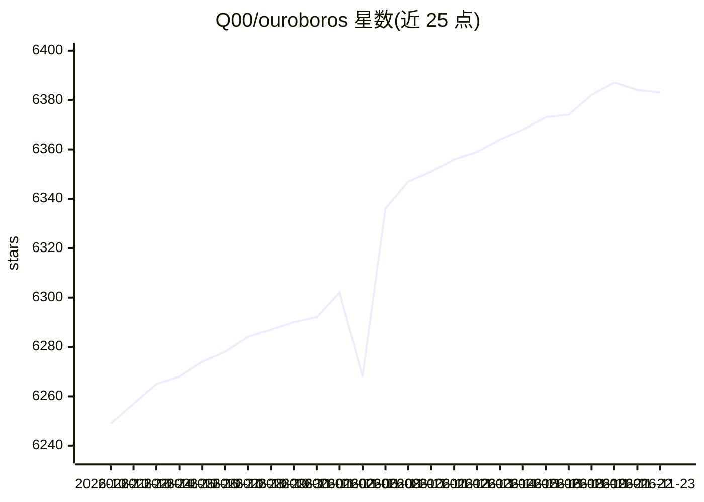

# Q00/ouroboros

⭐ 6,383 · Python · MIT · 推送 2026-11-22 · [GitHub](https://github.com/Q00/ouroboros) · [官网](https://ouroboros.page/) · 个人维护

**为已有 AI 编码代理提供访谈式规格先行与检查闭环的 MCP 工具**

Ouroboros 是面向 AI 编码代理的协调工具：通过提问访谈澄清目标，将结果写成带可验收标准的 spec（Seed），交给用户已有的编码代理执行，并逐条检查结果是否达标。以 MCP server 形式接入，宣称支持 14 个运行时（Claude Code、Codex CLI、Gemini CLI 等），提供浏览器控制台、CLI 命令（ooo interview/auto/run）与脚本安装器。Windows 原生为实验性，Codex CLI 需 WSL 2。

## 筛选速览

| 维度 | 判定 | 备注 |
|---|---|---|
| AI 角色 | `ai-ecosystem` | LLM/agent 周边工具 |
| 许可风险 | `permissive` | MIT |
| 部署形态 | `library` | 以包/库形式分发 |
| 模型依赖 | — | README 未给出锁定关系 |
| 硬件要求 | — | 无带数字的原话,不猜 |
| 安装摩擦 | `low` | 无编译、无系统依赖或容器化 |
| 成熟度 | — | 结构信号不足 |

## 能力要点

- 访谈-规格-执行-检查的闭环流程，spec 带可验收标准
- 以 MCP server 接入多个编码代理运行时
- 提供浏览器控制台与 CLI（ooo）两种使用方式
- 安装器自动发现并连接已有的代理工具

## 适用场景

- 在让代理动手前先把模糊需求澄清成规格
- 让多个编码代理按同一份 spec 构建并自动验收
- 在终端或控制台里驱动代理完成编码任务

## 场景标签

`编码 Agent` · 领域:编码与开发

## 证据(README 行号)

> L29: Ouroboros helps your AI coding agent build the right thing. It asks you
> L54: The installer finds the agent tools you already have and connects Ouroboros to
> L95: Claude Code ·

## 星数曲线

2026-10-21 6,249 → 2026-11-23 6,383（+134）

---
*卡片 v1 · prompt 1.4 · 生成 2026-11-22 · 置信度 mid · 依据 README sha `dbba0bb40ba1` · [字段定义](../../DATASET.md)*
