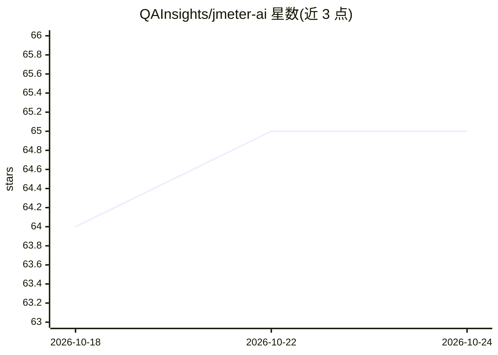

# QAInsights/jmeter-ai

⭐ 65 · Java · MIT · 推送 2026-10-23 · [GitHub](https://github.com/QAInsights/jmeter-ai) · [官网](https://jmeter.ai) · 个人维护

**Apache JMeter 的 AI 助手插件：聊天、Agent 改测试计划、提取器生成**

Feather Wand 是嵌入 Apache JMeter 的 AI 插件（jmeter-ai），面向性能测试工程师。提供多模型聊天（API 接入 Claude/OpenAI/Gemini/DeepSeek/Ollama/Grok/AWS Bedrock 等，或经 Codex/Claude Code CLI 账号）、JSR223 脚本 AI 重构、高亮响应值后自动生成并验证 JSON/CSS/正则/边界提取器的 Extract this 功能，以及通过 21 个工具自主编辑测试计划的 Agent 模式。以 JAR 形式经 JMeter Plugins Manager 或手动放入 lib/ext 安装，配置写入 user.properties；含每日匿名遥测 ping。

## 筛选速览

| 维度 | 判定 | 备注 |
|---|---|---|
| AI 角色 | `ai-native` | 本体是模型或模型工具 |
| 许可风险 | `permissive` | MIT |
| 部署形态 | `library` | 以包/库形式分发 |
| 模型依赖 | local-ok | 支持本地模型 |
| 硬件要求 | — | 无带数字的原话,不猜 |
| 安装摩擦 | `medium` | 含编译或系统依赖之一 |
| 成熟度 | — | 结构信号不足 |

## 能力要点

- Extract this：高亮响应值后生成并实测四类提取器，仅保留可精确取回该值的方案，无需 API key
- Agent 模式经 21 个工具自主编辑测试计划，支持 Jev 意图路由
- 多 provider 接入：API 与 CLI（Codex/Claude Code）双通道，含 Ollama 本地与 Apple 端侧模型
- 会话持久化、附件摘要（.jtl/日志）、上下文与成本统计

## 适用场景

- 在 JMeter 内对话式分析压测结果与脚本
- 从响应报文一键生成可用的关联提取器
- 让 AI Agent 直接修改和优化测试计划

## 场景标签

`编码 Agent` `AI 助手` · 领域:编码与开发

## 证据(README 行号)

> L5: **AI-powered assistant for Apache JMeter**
> L30: |🤖 **Multi-Model Chat**|Talk to API-backed Claude, OpenAI, Google Gemini, DeepSeek, Ollama, Grok (xAI), Meta Muse, 
> L33: |🎯 **Extract this**|Highlight a value in a View Results Tree response, right-click and pick **Extract this (Feather

## 星数曲线

2026-10-18 64 → 2026-10-24 65（+1）

---
*卡片 v1 · prompt 1.4 · 生成 2026-10-24 · 置信度 mid · 依据 README sha `55d4827e6c75` · [字段定义](../../DATASET.md)*
