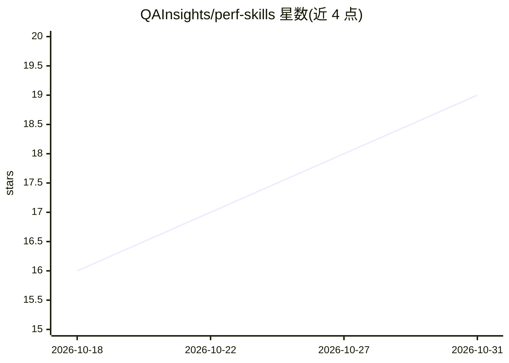

# QAInsights/perf-skills

⭐ 19 · MIT · 推送 2026-08-29 · [GitHub](https://github.com/QAInsights/perf-skills) · [官网](https://jmeter.ai) · 个人维护

**面向 AI 编码助手的高性能/负载测试知识库**

以 SKILL.md 为入口的结构化知识库，为 AI 编码助手按需注入性能测试领域知识，覆盖规划、脚本编写、执行与结果分析。支持 JMeter、k6、Gatling、Locust 等开源工具及 NeoLoad、LoadRunner 等商业工具，另含 LLM 推理基准测试与 SLO/容量规划主题。机制上采用选择性加载：先读 SKILL.md 路由，再按查询加载具体工具与主题文件以控制上下文占用。提供 Claude Code 插件、Qwen Code 技能、npx 及各编辑器手动安装方式；附 12 个评测用例验证知识库质量。

## 筛选速览

| 维度 | 判定 | 备注 |
|---|---|---|
| AI 角色 | `ai-knowledge` | 知识聚合/清单类 |
| 许可风险 | `permissive` | MIT |
| 部署形态 | `library` | 以包/库形式分发 |
| 模型依赖 | locked-api |  |
| 硬件要求 | — | 无带数字的原话,不猜 |
| 安装摩擦 | `low` | 无编译、无系统依赖或容器化 |
| 成熟度 | — | 结构信号不足 |

## 能力要点

- 覆盖开源与商业负载测试工具及 HTTP/gRPC/Kafka 等协议
- SKILL.md 路由 + 选择性加载设计控制上下文占用
- 动态值关联引擎：ViewState/CSRF/OAuth 等企业技术栈提取规则
- 12 个评测用例跨 8 类验证知识库输出质量

## 适用场景

- 让 AI 助手生成 k6/JMeter 等工具的正确负载测试脚本
- 咨询动态令牌关联、分布式执行与瓶颈分析
- 对 vLLM 等 LLM 推理端点做基准测试与容量规划
- 在 LoadRunner 与 k6 之间做迁移概念映射

## 场景标签

`知识库管理` · 领域:知识与检索

## 证据(README 行号)

> L3: > **Turn your AI assistant into a senior performance engineer.** An opinionated, token-optimized knowledge base for 
> L14: `perf-skills` is a highly structured knowledge base designed specifically for AI coding assistants (like Claude, Cu
> L169: 1. **Routing**: SKILL.md is always read first.

## 星数曲线

2026-10-18 16 → 2026-10-31 19（+3）

---
*卡片 v1 · prompt 1.4 · 生成 2026-10-29 · 置信度 high · 依据 README sha `8c5a9bda65ab` · [字段定义](../../DATASET.md)*
