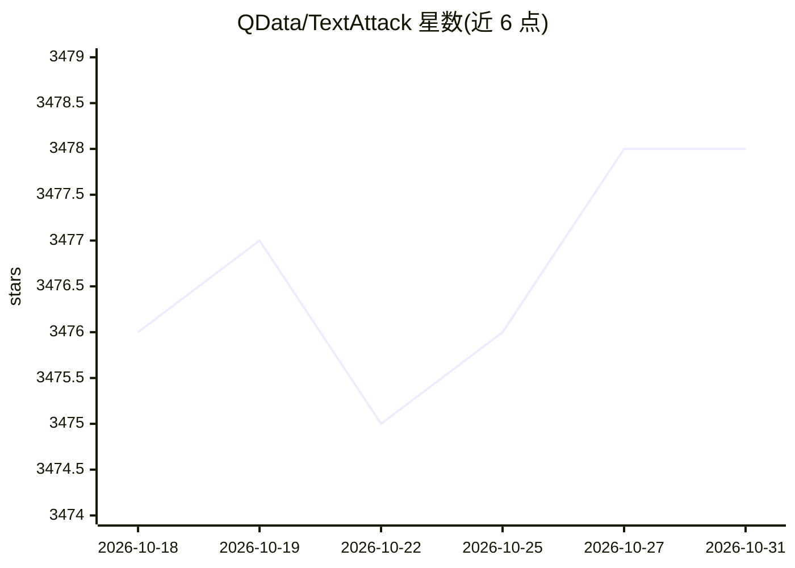

# QData/TextAttack

⭐ 3,478 · Python · MIT · 推送 2026-08-15 · [GitHub](https://github.com/QData/TextAttack) · [官网](https://textattack.readthedocs.io/en/master/) · 组织维护

**NLP 对抗攻击、数据增强与模型训练的 Python 框架**

面向 NLP 研究者与开发者的 Python 框架，提供三大功能：对 NLP 模型运行对抗攻击（内置 TextFooler、BERT-Attack、HotFlip、DeepWordBug 等十余个来自文献的攻击配方，覆盖分类与序列到序列任务）、基于变换与约束的数据增强（wordnet/embedding/charswap/eda/checklist 配方）、以及单命令训练 NLP 模型。通过 pip 安装，支持 CLI 与 Python 模块两种调用方式，可多 GPU 并行（--parallel）分布式攻击，缓存目录可通过 TA_CACHE_DIR 环境变量修改。需要 Python 3.6+，CUDA GPU 为可选加速项。

## 筛选速览

| 维度 | 判定 | 备注 |
|---|---|---|
| AI 角色 | `ai-ecosystem` | LLM/agent 周边工具 |
| 许可风险 | `permissive` | MIT |
| 部署形态 | `library` | 以包/库形式分发 |
| 模型依赖 | — | README 未给出锁定关系 |
| 硬件要求 | — | 无带数字的原话,不猜 |
| 安装摩擦 | `low` | 无编译、无系统依赖或容器化 |
| 成熟度 | — | 结构信号不足 |

## 能力要点

- 内置十余个来自文献的攻击配方（TextFooler、BERT-Attack、HotFlip、TextBugger 等）
- 支持分类与序列到序列模型的黑盒/白盒攻击
- 5 种数据增强内置配方（wordnet/embedding/charswap/eda/checklist）
- 单命令训练 NLP 模型，多 GPU 可用 --parallel 分布式攻击

## 适用场景

- 对 NLP 模型运行对抗攻击以理解其鲁棒性
- 研究和开发新的 NLP 对抗攻击方法
- 用变换+约束组合增强数据集以提升模型泛化
- 用单条命令训练并评测 NLP 模型

## 场景标签

`模型评测` `科研工具` · 领域:评测与运维

## 证据(README 行号)

> L23: TextAttack is a Python framework for adversarial attacks, data augmentation, and model training in NLP.
> L35: 1. **Understand NLP models better** by running different adversarial attacks on them and examining the output

## 星数曲线

2026-10-18 3,476 → 2026-10-31 3,478（+2）

---
*卡片 v1 · prompt 1.4 · 生成 2026-10-20 · 置信度 high · 依据 README sha `754d6017b211` · [字段定义](../../DATASET.md)*
