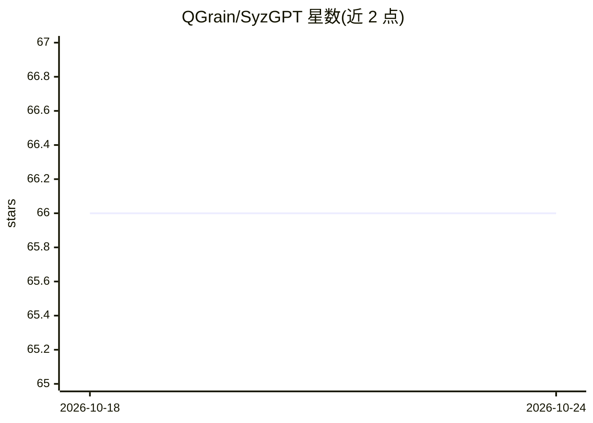

# QGrain/SyzGPT

⭐ 66 · Python · Apache-2.0 · 推送 2026-07-30 · [GitHub](https://github.com/QGrain/SyzGPT) · [官网](https://zhiyu.netlify.app/syzgpt-demo/) · 组织维护

**面向内核模糊测试的 LLM 种子生成框架，覆盖低频系统调用**

ISSTA 2025 论文实现：LLM 辅助的内核模糊测试框架，通过基于依赖的 RAG（DRAG）自动提取并增强低频系统调用（LFS）的依赖，为 Syzkaller 类模糊测试器生成有效种子，也可与自带 SyzGPT-fuzzer 配合进行持续内核模糊测试。支持 OpenAI API、第三方 API 或本地托管 LLM，附带微调模型 CodeLlama-syz-toy 与已提取的依赖数据。以 Docker 镜像或源码方式部署，持续模糊测试评估周期约 24 小时，种子生成需消耗 LLM token。

## 筛选速览

| 维度 | 判定 | 备注 |
|---|---|---|
| AI 角色 | `ai-native` | 本体是模型或模型工具 |
| 许可风险 | `permissive` | Apache-2.0 |
| 部署形态 | `self-host` | docker 或自建部署 |
| 模型依赖 | — | README 未给出锁定关系 |
| 硬件要求 | — | 无带数字的原话,不猜 |
| 安装摩擦 | `low` | 无编译、无系统依赖或容器化 |
| 成熟度 | — | 结构信号不足 |

## 能力要点

- 基于依赖的 RAG（DRAG）自动提取并增强系统调用依赖
- 可作为独立种子生成器或配合 SyzGPT-fuzzer 持续模糊测试
- 支持官方 OpenAI API、第三方 API 与本地托管 LLM
- 附带微调模型 CodeLlama-syz-toy 与已提取的依赖数据集

## 适用场景

- 为 Syzkaller 类内核模糊测试器生成低频系统调用种子
- 持续内核模糊测试以提升代码与系统调用覆盖率
- 复现论文中的种子生成与模糊测试实验

## 场景标签

 · 领域:系统安全/内核测试

## 证据(README 行号)

> L17: **Quick Glance**: SyzGPT is an LLM-assisted kernel fuzzing framework for automatically generating effective seeds f
> L15: This is the implementation of paper titled "**Unlocking Low Frequency Syscalls in Kernel Fuzzing with Dependency-Ba

## 星数曲线

2026-10-18 66 → 2026-10-24 66（+0）

---
*卡片 v1 · prompt 1.4 · 生成 2026-10-24 · 置信度 mid · 依据 README sha `3658d8877266` · [字段定义](../../DATASET.md)*
