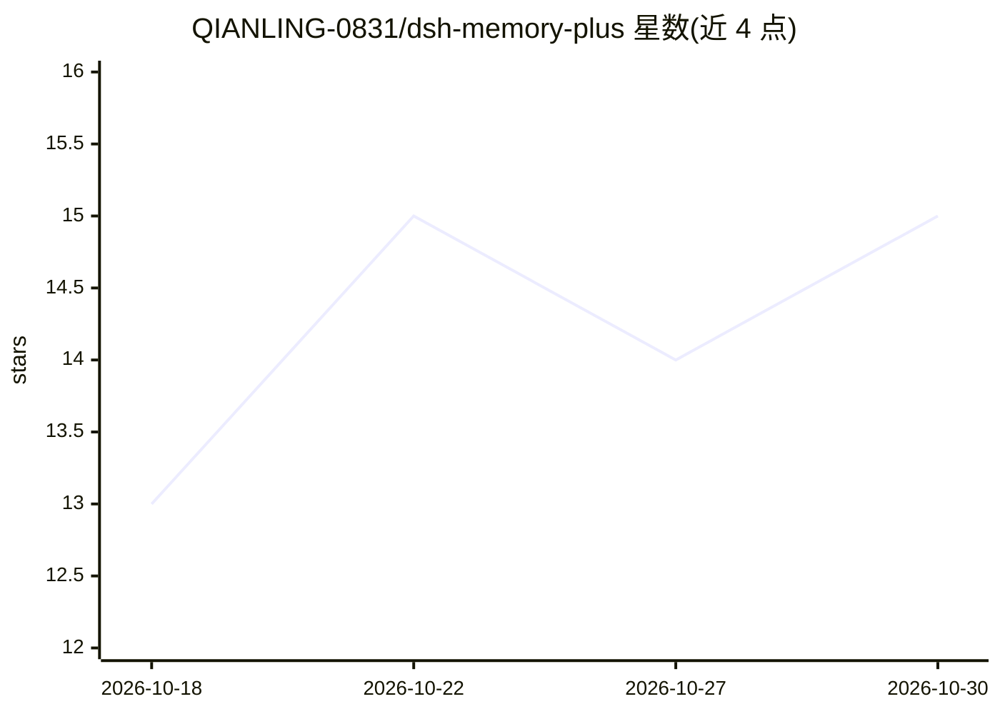

# QIANLING-0831/dsh-memory-plus

⭐ 15 · JavaScript · MIT · 推送 2026-10-22 · [GitHub](https://github.com/QIANLING-0831/dsh-memory-plus) · [官网](https://github.com/QIANLING-0831/dsh-memory-plus) · 个人维护 · 中文 README

**DeepSeek Harness 社区记忆插件集：中文检索、跨会话记忆与技能管理**

面向 DeepSeek Harness（DSH）宿主的 8 包社区记忆插件集：FTS5 trigram 双表加 LIKE 回退实现中文子串、中英混排与扩展汉字检索；sqlite-vec 向量臂加 FTS5 词法臂经 RRF 融合做混合召回；提供跨会话核心记忆库与系统提示注入、工具结果哈希去重、带来源定位符的压缩摘要，以及技能写入与后台反思蒸馏的自我进化。用户经斜杠命令固定的记忆与技能带 provenance，模型工具与后台进化无法改写，拒绝动作记入审计日志。宿主限定 DSH >=0.1.5-rc.3 <0.3.0，已在 0.1.5-rc.3 与 0.2.0-rc.2 验证；130 项自动测试。

## 筛选速览

| 维度 | 判定 | 备注 |
|---|---|---|
| AI 角色 | `ai-ecosystem` | LLM/agent 周边工具 |
| 许可风险 | `permissive` | MIT |
| 部署形态 | `library` | 以包/库形式分发 |
| 模型依赖 | locked-api |  |
| 硬件要求 | — | 无带数字的原话,不猜 |
| 安装摩擦 | `low` | 无编译、无系统依赖或容器化 |
| 成熟度 | `idea` | |

## 能力要点

- FTS5 trigram 双表 + 1–2 字 LIKE 回退的中文子串检索，支持扩展汉字与中英混排
- sqlite-vec 向量 + FTS5 词法 RRF 融合的混合记忆召回
- 跨会话核心记忆（Persistent Memory 区块稳定注入）与 memory_remember/memory_search 模型工具
- 来源 provenance + /skill-pin /memory-pin 固定层：模型工具与后台进化拒绝改写，拒绝进审计日志

## 适用场景

- 我在 DSH 中搜索中文历史会话，需要子串与扩展汉字可命中
- 跨会话保留项目偏好、约定与决策，新会话自动注入
- 让 agent 从完成回合蒸馏可复用技能，并保护我手写的技能不被改写
- 压缩后凭 Exact Sources 定位符找回原始细节

## 场景标签

`Agent 记忆` · 领域:Agent 开发

## 证据(README 行号)

> L3:  为 DeepSeek Harness 补齐中文检索、跨会话记忆与可复用技能。
> L30: DeepSeek Harness（DSH）的社区记忆插件集，共 8 个包：让中文子串、中英混排和扩展汉字可检索，并提供工具结果去重、向量与全文混合召回、跨会话核心记忆、可追溯压缩和技能管理。用户固定的记忆与技能带来源记录，模型工具
> L34: DSH `>=0.1.5-rc.3 <0.3.0`（cordis `^4.0.1`），已在 `0.1.5-rc.3` 与 `0.2.0-rc.2` 上验证。`ctx.sessionQuery` 由本仓的 CJK 插件作为上游 `S

## 星数曲线

2026-10-18 13 → 2026-10-30 15（+2）

---
*卡片 v1 · prompt 1.4 · 生成 2026-10-30 · 置信度 mid · 依据 README sha `d19fcedf91a3` · [字段定义](../../DATASET.md)*
