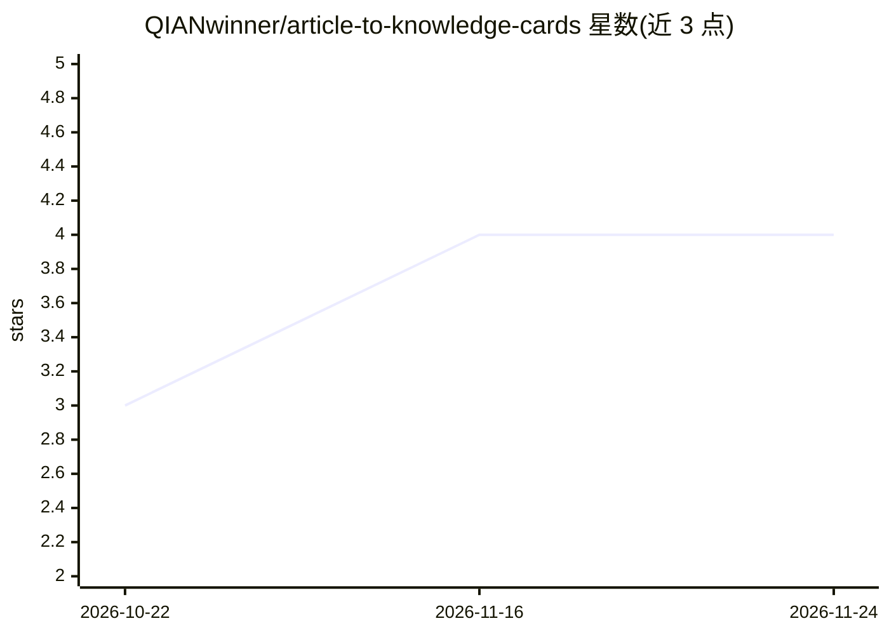

# QIANwinner/article-to-knowledge-cards

⭐ 4 · JavaScript · MIT · 推送 2026-11-22 · [GitHub](https://github.com/QIANwinner/article-to-knowledge-cards) · [官网](https://qianwinner.github.io/article-to-knowledge-cards/) · 个人维护 · 中文 README

**把文章/本地 Markdown 转成可溯源知识卡片的 Agent Skill**

一个 Agent Skill 与配套本地 GUI：将粘贴的文章或本地 Markdown/TXT 转成最多 128 张知识卡片，每张含标题、核心知识、解释与例子/自测题。规则引擎要求卡片内容可逐字回溯原文，禁止引入外部定义与数字，待办/预测不做卡，数量由原文决定。v0.1.5 起卡片可存入本机卡片库（localStorage），逐张编辑、打标签、导出 Anki CSV/Obsidian/JSON，并按 SM-2 变体安排间隔复习。Skill 本身零依赖、不联网；GUI 需 Node.js≥18，另有 Tauri 打包的 2.5 MB Windows exe。

## 筛选速览

| 维度 | 判定 | 备注 |
|---|---|---|
| AI 角色 | `ai-native` | 本体是模型或模型工具 |
| 许可风险 | `permissive` | MIT |
| 部署形态 | `desktop` | 安装包/桌面程序 |
| 模型依赖 | — | README 未给出锁定关系 |
| 硬件要求 | — | 无带数字的原话,不猜 |
| 安装摩擦 | `medium` | 含编译或系统依赖之一 |
| 成熟度 | — | 结构信号不足 |

## 能力要点

- 硬约束保证卡片可逐字回溯原文，不编造、不凑数
- 本地卡片库支持编辑、标签、Anki/Obsidian/JSON 导出
- SM-2 变体间隔重复复习调度
- 提供在线 Demo（GitHub Pages）与 2.5 MB Windows exe

## 适用场景

- 读完文章后快速整理成可复习的知识卡片
- 把本地 Markdown 笔记导出到 Anki 或 Obsidian
- 在断网环境下本机处理文章并保留卡片库

## 场景标签

`知识库管理` · 领域:知识与检索

## 证据(README 行号)

> L9: 这是一个 Agent Skill，只输出一份 Markdown 文本，没有界面、没有依赖、不联网。仓库同时附带一个本地 GUI 与 2.5 MB 的 Windows 可执行文件。
> L330: **规则引擎**：前端的 `card-engine.js` 实现了 SKILL.md 的硬约束——资格判定（待办、计划、预测、未决问题不做卡）、单卡单知识点、重复合并、可溯源（卡片内容必须能逐字回溯原文）、不凑数（原文支持几张就

## 星数曲线

2026-10-22 3 → 2026-11-24 4（+1）

---
*卡片 v1 · prompt 1.4 · 生成 2026-11-21 · 置信度 high · 依据 README sha `eac1ec7e526a` · [字段定义](../../DATASET.md)*
