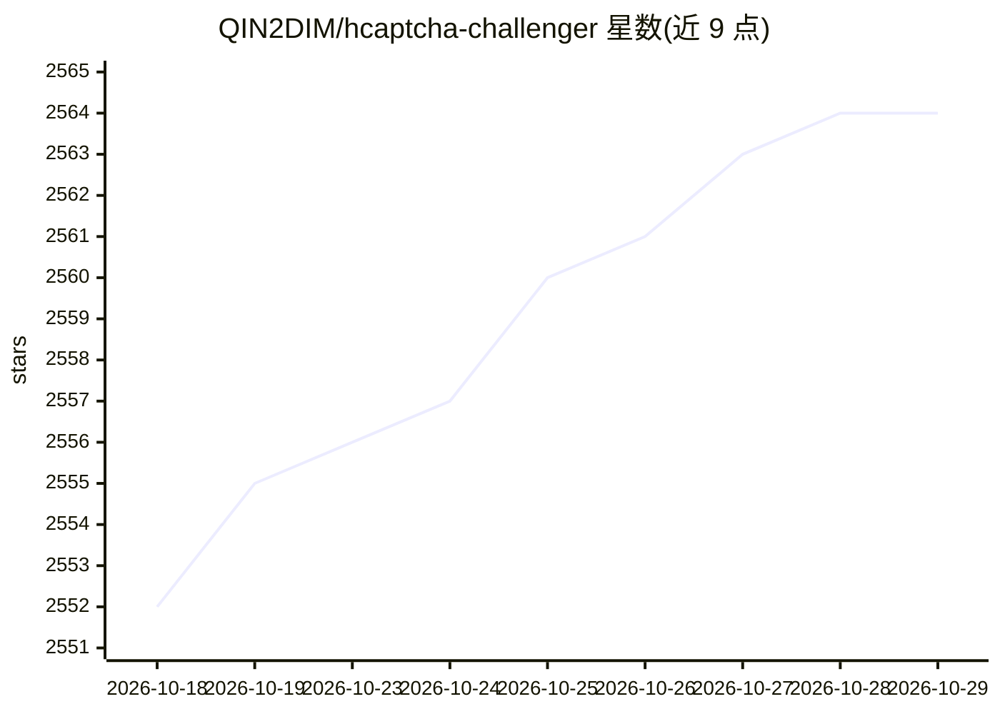

# QIN2DIM/hcaptcha-challenger

⭐ 2,564 · Python · GPL-3.0 · 推送 2026-08-15 · [GitHub](https://github.com/QIN2DIM/hcaptcha-challenger) · 个人维护 · 中文 README

**用多模态大模型与视觉模型自动求解 hCaptcha 验证码的工具库**

面向自动化 Web Agent 开发者的 hCaptcha 求解库：不依赖油猴脚本或第三方打码服务，通过可插拔的视觉模型资源应对多类挑战，包括 ResNet ONNX 分类、YOLOv8 ONNX 检测/分割、ViT 零样本判断、CLIP-ViT 自监督挑战，以及基于多模态大模型的空间思维链与 Agentic Workflow。配套工作流覆盖数据集标注（roboflow）、模型训练与上传。挑战类型支持度以表格列明，部分类型无 Agent 能力。

## 筛选速览

| 维度 | 判定 | 备注 |
|---|---|---|
| AI 角色 | `ai-native` | 本体是模型或模型工具 |
| 许可风险 | `viral` | GPL-3.0 |
| 部署形态 | `None` |  |
| 模型依赖 | — | README 未给出锁定关系 |
| 硬件要求 | — | 无带数字的原话,不猜 |
| 安装摩擦 | `low` | 无编译、无系统依赖或容器化 |
| 成熟度 | — | 结构信号不足 |

## 能力要点

- 按挑战类型提供可插拔模型资源（ResNet/YOLOv8/ViT/CLIP）
- 空间思维链与多模态大模型驱动的 Agentic Workflow
- 不依赖油猴脚本与第三方打码服务
- 配套数据集标注与模型训练工作流

## 适用场景

- 让基于 Playwright 的 Web Agent 通过 hCaptcha 验证
- 研究视觉模型在验证码挑战上的应用
- 构建自动化浏览任务中的验证码处理环节

## 场景标签

 · 领域:Web 自动化/验证码求解

## 证据(README 行号)

> L14: Just implement some interfaces to make `AI vs AI` possible.
> L22: |`image_label_binary`|ResNet ONNX classification #220401|✅|
> L32: |`Agentic Workflow`|AIOps Multimodal Large language model #250331|

## 星数曲线

2026-10-18 2,552 → 2026-10-29 2,564（+12）

---
*卡片 v1 · prompt 1.4 · 生成 2026-10-21 · 置信度 high · 依据 README sha `78fedf3b6289` · [字段定义](../../DATASET.md)*
