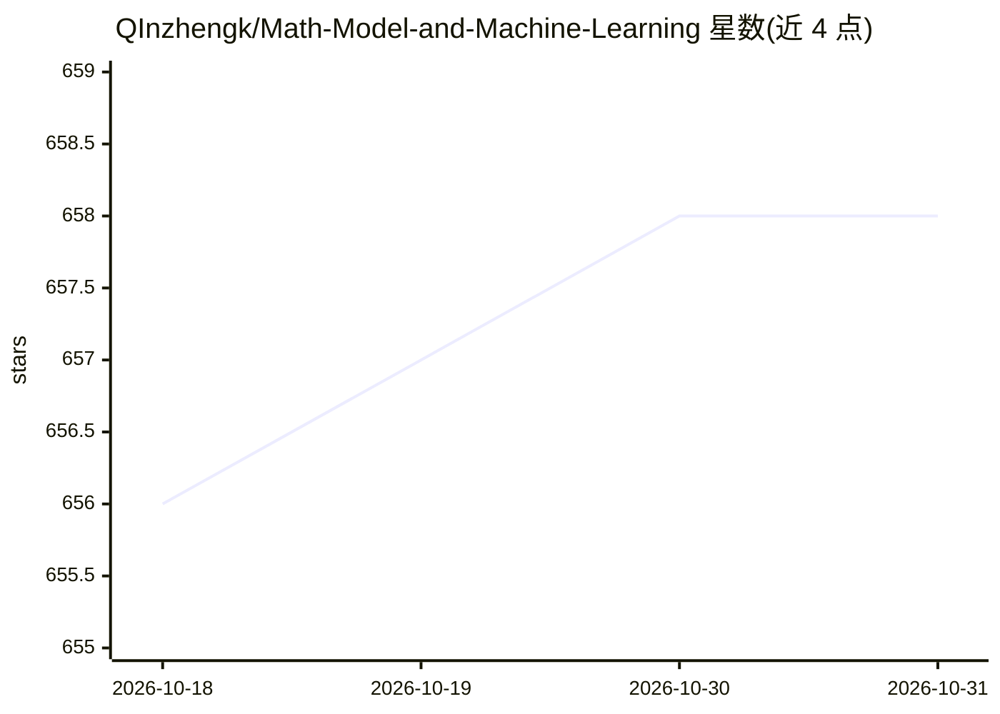

# QInzhengk/Math-Model-and-Machine-Learning

⭐ 658 · Jupyter Notebook · 推送 2026-10-24 · [GitHub](https://github.com/QInzhengk/Math-Model-and-Machine-Learning) · [官网](https://zread.ai/QInzhengk/Math-Model-and-Machine-Learning) · 个人维护 · 中文 README

**数学建模与机器学习/深度学习/大模型的学习资料合集**

个人维护的学习笔记与资料整理仓库，覆盖数学建模竞赛（国赛、美赛、研赛等十余项赛事的优秀论文、书籍、模板、算法与课件）及人工智能（机器学习、深度学习、大模型）方向的资料。面向初学者，内容持续更新中，大于25M的文件未上传，需通过微信公众号获取。提供QQ群、QQ频道、知乎圈子等交流渠道，接受社区PR贡献。

## 筛选速览

| 维度 | 判定 | 备注 |
|---|---|---|
| AI 角色 | `ai-knowledge` | 知识聚合/清单类 |
| 许可风险 | `none` | — |
| 部署形态 | `None` |  |
| 模型依赖 | — | README 未给出锁定关系 |
| 硬件要求 | — | 无带数字的原话,不猜 |
| 安装摩擦 | `low` | 无编译、无系统依赖或容器化 |
| 成熟度 | — | 结构信号不足 |

## 能力要点

- 收录十余项数学建模竞赛的优秀论文与赛题资料
- 包含数学建模书籍、模板、算法、课件分类索引
- 覆盖机器学习、深度学习、大模型方向的资料
- 通过微信公众号补充获取大体积文件

## 适用场景

- 数学建模竞赛备赛时查找优秀论文与算法资料
- 机器学习/深度学习/大模型入门学习参考
- 按竞赛类型浏览历年赛题与评阅要点

## 场景标签

`精选清单` · 领域:学习与行业

## 证据(README 行号)

> L11: > :corn: 此项目为自学数学建模和人工智能（机器学习/深度学习/大模型）的分享，整理了许多笔记和资料（**持续更新中......**）。
> L46: └── 人工智能         各种深度学习、机器学习和大模型的资料

## 星数曲线

2026-10-18 656 → 2026-10-31 658（+2）

---
*卡片 v1 · prompt 1.4 · 生成 2026-10-21 · 置信度 high · 依据 README sha `885c1c29bd9a` · [字段定义](../../DATASET.md)*
