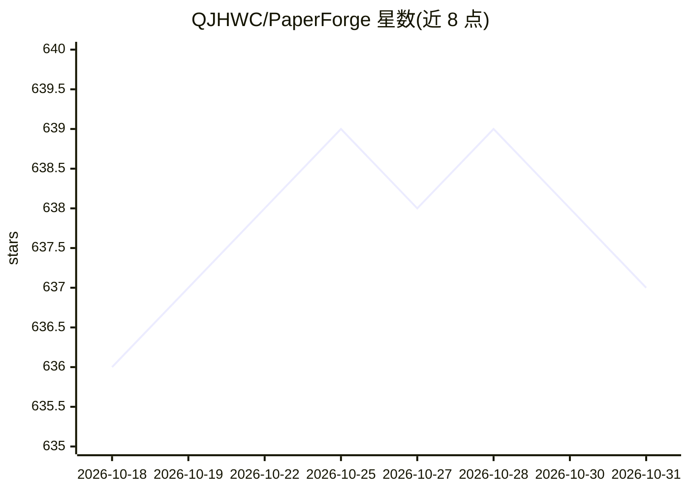

# QJHWC/PaperForge

⭐ 637 · Python · NOASSERTION · 推送 2026-10-13 · [GitHub](https://github.com/QJHWC/PaperForge) · 个人维护 · 中文 README

**以证据为中心的端到端 AI 论文写作与实验系统**

面向科研人员的 Research OS：覆盖研究规划、文献研究、受控实验（Proposal→静态检查→小实验→正式实验，需审批）、论文写作与 LaTeX 发布。论文断言须通过 claim_id 关联证据，发布前有 Claim Gate 与多级门禁。计算后端支持 Local、Docker、SSH、Slurm、Kubernetes、Cloud SSH。当前正式写作路径固定使用 bailu Provider 与 bailu-turing 模型，配置中的 provider/model 不会注入写作 Agent；声明仅供学习研究、禁止商用。

## 筛选速览

| 维度 | 判定 | 备注 |
|---|---|---|
| AI 角色 | `ai-native` | 本体是模型或模型工具 |
| 许可风险 | `none` | NOASSERTION |
| 部署形态 | `library` | 以包/库形式分发 |
| 模型依赖 | — | README 未给出锁定关系 |
| 硬件要求 | — | 无带数字的原话,不猜 |
| 安装摩擦 | `low` | 无编译、无系统依赖或容器化 |
| 成熟度 | — | 结构信号不足 |

## 能力要点

- SQLite Scientific Memory 统一保存 Claim、Evidence、Run 与 Artifact
- 六种计算后端（Local/Docker/SSH/Slurm/Kubernetes/Cloud SSH）统一接口
- writing-only/research/full 三种强制执行策略与实验审批流程
- Claim Gate + 最多三轮 LaTeX 编译渲染的发布流水线，支持 Generic/CVPR/IEEE/Elsevier 模板

## 适用场景

- 在已有实验结果基础上完成带证据溯源的论文写作与 LaTeX 发布
- 通过 SSH/Slurm/Kubernetes 后端远程执行实验并追踪产物
- 对论文公开断言做 Claim–Evidence 关联与发布门禁检查

## 场景标签

`科研工具` `AI 写作` · 领域:内容生成

## 证据(README 行号)

> L12: PaperForge v3 是一个以证据为中心的科研工作系统，用于研究规划、受控实验、
> L148: 当前 v3 正式写作路径固定使用 `bailu` Provider 和 `bailu-turing` 模型。

## 星数曲线

2026-10-18 636 → 2026-10-31 637（+1）

---
*卡片 v1 · prompt 1.4 · 生成 2026-10-21 · 置信度 high · 依据 README sha `870fc9ce0b20` · [字段定义](../../DATASET.md)*
