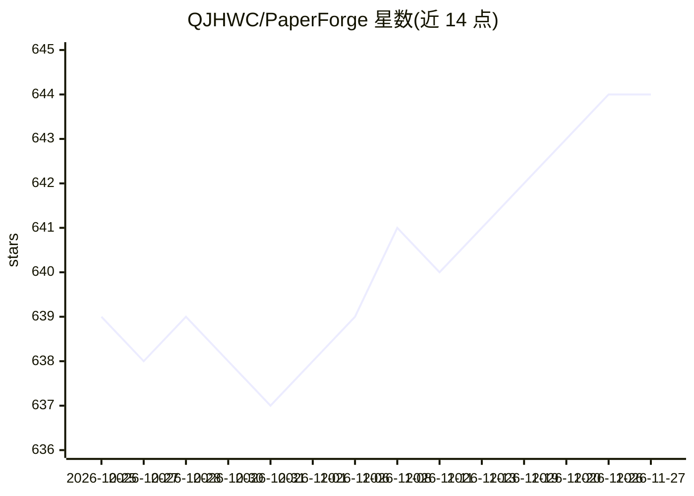

# QJHWC/PaperForge

⭐ 644 · Python · NOASSERTION · 推送 2026-11-16 · [GitHub](https://github.com/QJHWC/PaperForge) · 个人维护 · 中文 README

**面向科研人员的 AI 端到端论文写作与实验工作流系统**

PaperForge v3 以证据为中心组织科研工作：研究规划、实验提案与审批、论文写作、LaTeX 编译、Claim Gate 发布门禁均在统一 CLI/浏览器前端工作流中完成。断言必须通过 claim_id 关联源码、文献与运行结果等证据，SQLite Scientific Memory 保存工作流与产物哈希。支持 writing-only、research、full 三种执行策略，Local/Docker/SSH/Slurm/Kubernetes 等计算后端。正式写作路径固定使用 bailu-turing 模型；LaTeX 与 Poppler 缺失时无法完成正式 PDF 发布。

## 筛选速览

| 维度 | 判定 | 备注 |
|---|---|---|
| AI 角色 | `ai-native` | 本体是模型或模型工具 |
| 许可风险 | `none` | NOASSERTION |
| 部署形态 | `library` | 以包/库形式分发 |
| 模型依赖 | — | README 未给出锁定关系 |
| 硬件要求 | — | 无带数字的原话,不猜 |
| 安装摩擦 | `low` | 无编译、无系统依赖或容器化 |
| 成熟度 | — | 结构信号不足 |

## 能力要点

- 论文公开断言须通过 Claim Gate 关联可验证证据
- 六种计算后端（Local/Docker/SSH/Slurm/Kubernetes/Cloud SSH）统一接口
- 支持 Generic/CVPR/IEEE/Elsevier 四种模板及三轮编译渲染闭环
- writing-only 策略在四层拒绝训练与实验命令

## 适用场景

- 已有实验数据，只需完成论文写作与 LaTeX 编译
- 从研究问题出发规划实验并经审批执行完整科研流程
- 将实验提交到 Slurm 集群或 SSH 远程主机并同步产物

## 场景标签

`科研工具` `AI 写作` · 领域:内容生成

## 证据(README 行号)

> L8: PaperForge v3 是一个以证据为中心的科研工作系统，用于研究规划、受控实验、
> L164: 当前 v3 正式写作路径固定使用 `bailu` Provider 和 `bailu-turing` 模型。
> L298: |`writing-only`|证据阅读、引用、写作、LaTeX 编译、页面检查|已有实验结果，只完成论文|

## 星数曲线

2026-10-25 639 → 2026-11-27 644（+5）

---
*卡片 v1 · prompt 1.4 · 生成 2026-11-24 · 置信度 high · 依据 README sha `b64efd62396c` · [字段定义](../../DATASET.md)*
