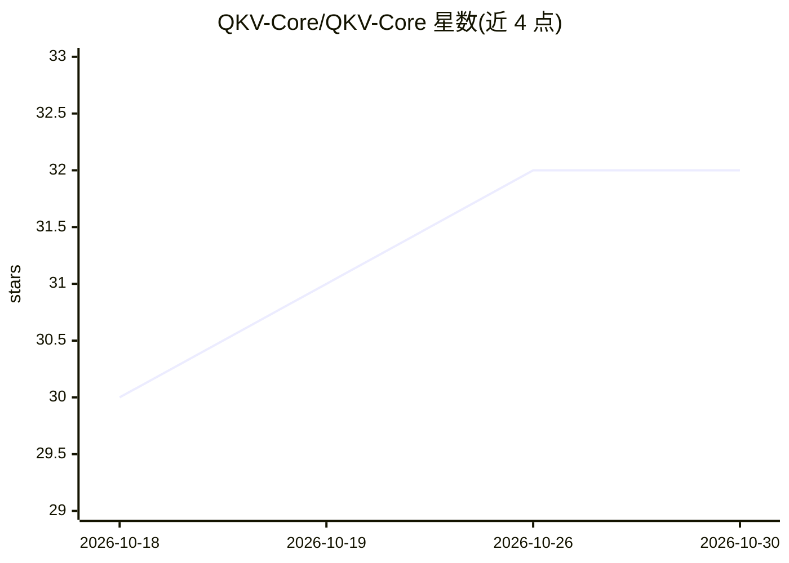

# QKV-Core/QKV-Core

⭐ 32 · Python · MIT · 推送 2026-01-14 · [GitHub](https://github.com/QKV-Core/QKV-Core) · [官网](https://QKV-Core.github.io/QKV-Core) · 个人维护

**让 7B LLM 在 4GB 旧显卡上运行的混合量化框架**

面向低显存设备的 LLM 部署与训练框架：实现 GPT 风格 Transformer 的完整训练、增量训练与微调（含 LoRA/QLoRA、RLHF/DPO），支持 PyTorch .pt 与 GGUF 模型格式，可从 Hugging Face Hub 下载并转换模型。针对 GTX 1050 等 4GB Pascal 显卡提供加速 offload、bitsandbytes 量化与显存碎片缓解方案。提供 Gradio Web UI 与 CLI 两种使用方式，推理部分使用 Numba 加速。

## 筛选速览

| 维度 | 判定 | 备注 |
|---|---|---|
| AI 角色 | `ai-ecosystem` | LLM/agent 周边工具 |
| 许可风险 | `permissive` | MIT |
| 部署形态 | `library` | 以包/库形式分发 |
| 模型依赖 | local-ok | 支持本地模型 |
| 硬件要求 | `gpu-8g` | |
| 安装摩擦 | `low` | 无编译、无系统依赖或容器化 |
| 成熟度 | — | 结构信号不足 |

## 能力要点

- 支持在 4GB 显存（GTX 1050/1650）上运行 7B 量化模型
- 支持 GGUF 与 PyTorch .pt 模型格式及 Hugging Face Hub 下载转换
- 训练/微调能力：LoRA、QLoRA、RLHF、DPO
- Gradio Web UI 与 CLI 双界面，accelerate offload 与 bitsandbytes 可选量化

## 适用场景

- 在 GTX 1050 等 4GB 旧显卡上运行 7B 量化模型
- 对中小型 Transformer 模型做训练与 LoRA/QLoRA 微调
- 通过 Web UI 完成 GGUF 模型的下载、转换与推理

## 场景标签

`微调` `模型量化` `强化学习` `推理引擎` · 领域:训练与推理

## 证据(README 行号)

> L3: > **Run modern 7B LLMs (like Qwen 2.5, Llama 3) on legacy 4GB GPUs (GTX 1050/1650) without crashing.**
> L23: - **Transformer Architecture**: Full implementation of GPT-style transformer models
> L100: This project includes features and helper scripts to support running a hybrid BitNet model on limited GPUs (4GB Pa

## 星数曲线

2026-10-18 30 → 2026-10-30 32（+2）

---
*卡片 v1 · prompt 1.4 · 生成 2026-10-26 · 置信度 mid · 依据 README sha `08a7db4c2c65` · [字段定义](../../DATASET.md)*
