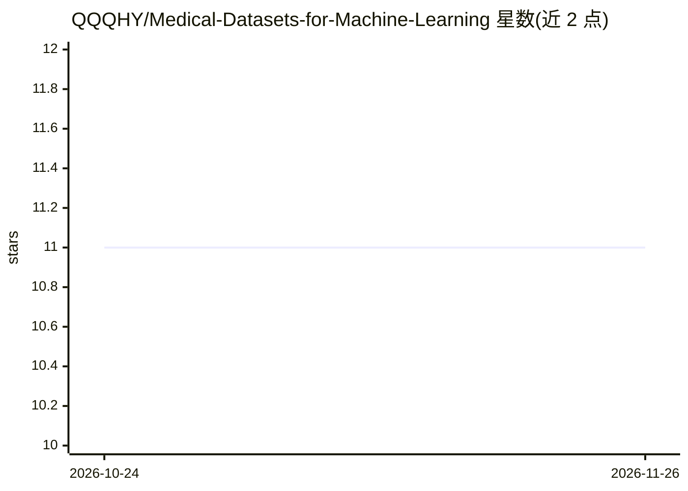

# QQQHY/Medical-Datasets-for-Machine-Learning

⭐ 11 · Python · NOASSERTION · 推送 2026-06-29 · [GitHub](https://github.com/QQQHY/Medical-Datasets-for-Machine-Learning) · 个人维护 · 中文 README

**面向机器学习研究者的医学数据集编目清单**

医学数据集的结构化编目，继承并扩展 beamandrew/medical-data：为每个条目提供模态、任务、规模、访问方式、许可证、核验日期等元数据表，并附 DOI 优先的原始文献引用与获取链接。覆盖放射影像（CT/CXR/MRI/乳腺钼靶/显微镜）等多个类别，采用双语（英文|中文）文档，欢迎通过 CONTRIBUTING.md 贡献条目。声明仅作信息用途，使用者需遵守各数据集自身的许可与访问限制。

## 筛选速览

| 维度 | 判定 | 备注 |
|---|---|---|
| AI 角色 | `ai-knowledge` | 知识聚合/清单类 |
| 许可风险 | `none` | NOASSERTION |
| 部署形态 | `None` |  |
| 模型依赖 | — | README 未给出锁定关系 |
| 硬件要求 | — | 无带数字的原话,不猜 |
| 安装摩擦 | `low` | 无编译、无系统依赖或容器化 |
| 成熟度 | — | 结构信号不足 |

## 能力要点

- 条目含模态/任务/规模/访问/许可/核验日期的结构化元数据表
- DOI 优先的文献引用与数据集获取链接
- 覆盖 CT、CXR、MRI、乳腺钼靶、显微镜等多模态影像数据集
- 双语文档（英文|中文）

## 适用场景

- 查找医学影像任务（分类/分割/检测）可用的公开数据集
- 按许可证与访问限制筛选适合研究用途的医学数据
- 补充亚太地区医学数据资源线索

## 场景标签

`精选清单` · 领域:学习与行业

## 证据(README 行号)

> L5: > Curated catalog of medical datasets for machine learning research. For informational purposes only; respect each d
> L7: This catalog extends beamandrew/medical-data with structured metadata, DOI-first citations, bilingual documentation,

## 星数曲线

2026-10-24 11 → 2026-11-26 11（+0）

---
*卡片 v1 · prompt 1.4 · 生成 2026-11-18 · 置信度 high · 依据 README sha `605688cda3b4` · [字段定义](../../DATASET.md)*
