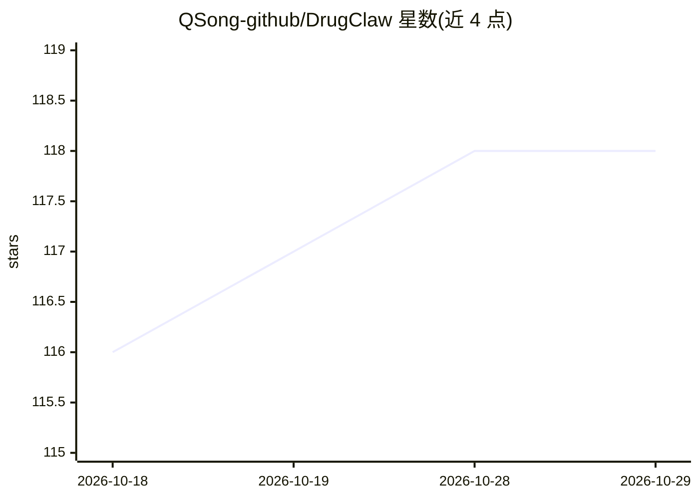

# QSong-github/DrugClaw

⭐ 118 · Python · 推送 2026-08-25 · [GitHub](https://github.com/QSong-github/DrugClaw) · [官网](https://qsong-github.github.io/DrugClaw/) · 组织维护 · 中文 README

**面向药物知识问答的 Agentic RAG 命令行工具：证据溯源回答**

DrugClaw 是一个以药物问题为对象的 CLI 与 agent 运行时，覆盖药物靶点、适应症与老药新用、安全性风险、药物相互作用、药物基因组学与标签信息等任务类别。基于 LangGraph，强调证据落地的检索、来源归因与可追溯性，而非仅生成流畅文本。提供轻量 minimal 模式与更完整的 full 本地资源模式（后者资源包待论文录用后发布）。通过 git clone 源码加 pip 安装使用，需配置 api_keys.json 指定 API key 与模型，内置 doctor 环境检查、list 资源列举与 demo 流程。

## 筛选速览

| 维度 | 判定 | 备注 |
|---|---|---|
| AI 角色 | `ai-native` | 本体是模型或模型工具 |
| 许可风险 | `none` | — |
| 部署形态 | `library` | 以包/库形式分发 |
| 模型依赖 | — | README 未给出锁定关系 |
| 硬件要求 | — | 无带数字的原话,不猜 |
| 安装摩擦 | `low` | 无编译、无系统依赖或容器化 |
| 成熟度 | — | 结构信号不足 |

## 能力要点

- 面向靶点/DDI/PGx/重定位等药物任务的 Agentic RAG，强调证据溯源与来源归因
- 双模式：默认轻量 minimal 模式与待发布的 full 本地资源包模式
- 内置 doctor 环境校验、资源列表与 demo 命令
- 提供 arXiv 论文与中英双语文档

## 适用场景

- 查询某药物的已知靶点与作用机制
- 核查华法林等药物的临床重要相互作用
- 检索药物基因组学因素对药效与安全的影响
- 获取带来源归因的药物安全与重定位证据

## 场景标签

`RAG` `科研工具` · 领域:知识与检索

## 证据(README 行号)

> L17: DrugClaw is a CLI and agent runtime for drug-focused questions. It prioritizes evidence-grounded retrieval, source 
> L21: - It is not a general chat assistant. It is built for real drug questions such as targets, indications, repurposing
> L80: - Drug targets and mechanisms

## 星数曲线

2026-10-18 116 → 2026-10-29 118（+2）

---
*卡片 v1 · prompt 1.4 · 生成 2026-10-23 · 置信度 mid · 依据 README sha `6bd70ae6f3da` · [字段定义](../../DATASET.md)*
