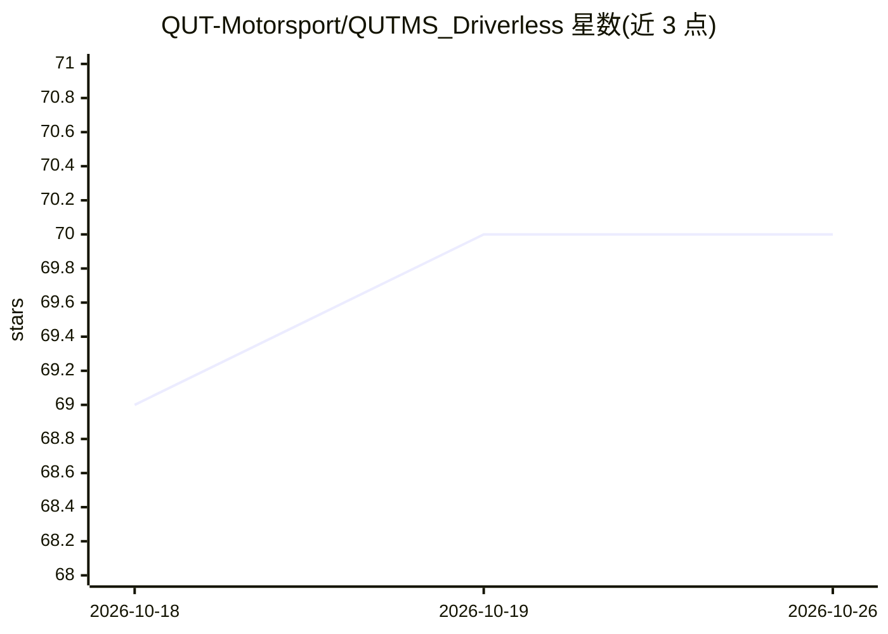

# QUT-Motorsport/QUTMS_Driverless

⭐ 70 · Python · MIT · 推送 2026-10-20 · [GitHub](https://github.com/QUT-Motorsport/QUTMS_Driverless) · 组织维护

**面向 FSAE 无人赛车的 ROS2 感知规划控制软件栈**

昆士兰科技大学赛车队 QUTMS 的自动驾驶子系统仓库：基于 ROS 2 开发电动方程式赛车 QEV-3D 的感知、规划与控制管线。感知部分使用 LiDAR 与相机数据，结合机器学习和聚类模型检测赛道锥桶；导航与制导栈采用 Nav2 的现成 ROS 2 库完成建图、规划与控制，并附 arXiv 论文（2311.14276）。车辆已退役竞赛，2025 年起作为自主测试平台继续维护。README 未给出安装命令。

## 筛选速览

| 维度 | 判定 | 备注 |
|---|---|---|
| AI 角色 | `ai-native` | 本体是模型或模型工具 |
| 许可风险 | `permissive` | MIT |
| 部署形态 | `None` |  |
| 模型依赖 | — | README 未给出锁定关系 |
| 硬件要求 | — | 无带数字的原话,不猜 |
| 安装摩擦 | `low` | 无编译、无系统依赖或容器化 |
| 成熟度 | — | 结构信号不足 |

## 能力要点

- 基于 ROS 2 的感知/规划/控制管线，用于无人 FSAE 赛车
- 使用机器学习与聚类模型检测赛道锥桶
- 导航栈采用 Nav2 现成库实现建图、规划与控制

## 适用场景

- 参考 FSAE 无人赛车全套软件栈的实现
- 复用锥桶检测与 Nav2 导航集成的方案
- 了解学生车队自动驾驶系统的开发历程与测试方式

## 场景标签

`目标检测` · 领域:感知与多模态

## 证据(README 行号)

> L1: # QUTMS Driverless
> L6: QEV-3D, *Lando*, has been the first testbench for the Autonomous team and was used for hardware testing throughout 2
> L18: The Autonomous System is developed using the Robot Operating System (ROS2), for efficient data transfer and package

## 星数曲线

2026-10-18 69 → 2026-10-26 70（+1）

---
*卡片 v1 · prompt 1.4 · 生成 2026-10-24 · 置信度 mid · 依据 README sha `b31a6a48a177` · [字段定义](../../DATASET.md)*
