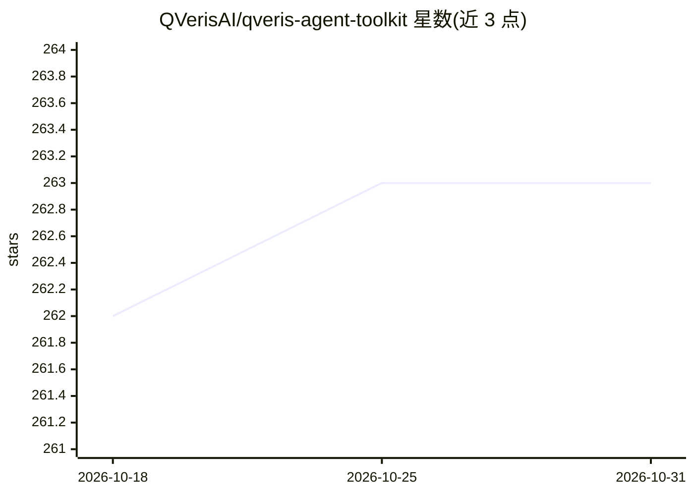

# QVerisAI/qveris-agent-toolkit

⭐ 263 · JavaScript · MIT · 推送 2026-10-30 · [GitHub](https://github.com/QVerisAI/qveris-agent-toolkit) · [官网](https://qveris.ai/) · 组织维护 · 中文 README

**让 AI agent 接入专业数据与工具的开源客户端工具集**

QVeris 是面向 AI 助手与 agent 的专业数据/工具访问平台的开源客户端工具集（monorepo）：提供 CLI、MCP server、Python SDK、TypeScript SDK、REST API 文档与 agent skills，让 agent 通过 Discover（免费自然语言找服务）→ Inspect → Call 工作流调用金融、搜索、天气、地图、文档、区块链、医疗等类别服务，并用 usage audit 与 credits ledger 审计用量和计费。CLI 经 npm 或 curl 脚本安装，需 API key，采用按量计费（免费层含 1,000 试用 credits）；MCP 为托管服务端。

## 筛选速览

| 维度 | 判定 | 备注 |
|---|---|---|
| AI 角色 | `ai-ecosystem` | LLM/agent 周边工具 |
| 许可风险 | `permissive` | MIT |
| 部署形态 | `library` | 以包/库形式分发 |
| 模型依赖 | — | README 未给出锁定关系 |
| 硬件要求 | — | 无带数字的原话,不猜 |
| 安装摩擦 | `low` | 无编译、无系统依赖或容器化 |
| 成熟度 | — | 结构信号不足 |

## 能力要点

- CLI / MCP server / Python SDK / TypeScript SDK / REST API 多种接入方式
- Discover→Inspect→Call 服务发现与调用工作流，Discover 免费
- usage audit 与 credits ledger 审计请求与扣费记录
- 兼容 OpenClaw / Claude Code / Cursor / OpenCode / Trae / Gemini CLI

## 适用场景

- 让我的 coding agent 能按需发现并调用专业数据服务
- 在 Cursor / Claude Code 中通过 MCP 接入 QVeris 服务目录
- 审计 agent 的服务调用量与 credit 扣费明细

## 场景标签

 · 领域:AI agent 基础设施/数据服务接入

## 证据(README 行号)

> L5:  Bring professional data to the AI you already use.
> L61: > → **QVeris CLI** — `npm install -g @qverisai/cli` or `curl -fsSL https://qveris.ai/cli/install | bash`
> L264: |MCP Server|`packages/mcp`|@qverisai/mcp|

## 星数曲线

2026-10-18 262 → 2026-10-31 263（+1）

---
*卡片 v1 · prompt 1.4 · 生成 2026-10-22 · 置信度 high · 依据 README sha `fe1379bb643f` · [字段定义](../../DATASET.md)*
