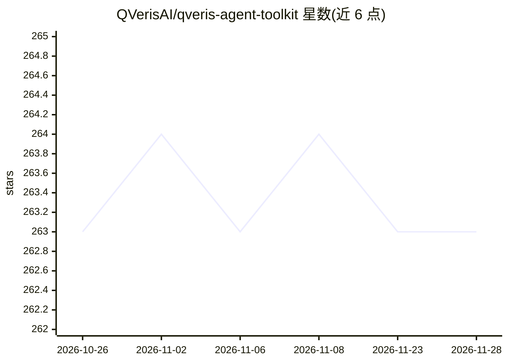

# QVerisAI/qveris-agent-toolkit

⭐ 263 · JavaScript · MIT · 推送 2026-11-27 · [GitHub](https://github.com/QVerisAI/qveris-agent-toolkit) · [官网](https://qveris.ai/) · 组织维护

**让 AI 助手发现并调用专业数据服务的 MCP/CLI/SDK 工具包**

QVeris 是面向 AI 的专业数据与工具访问平台，本开源工具包提供 CLI、MCP server、Python/TypeScript SDK、技能文件与 REST API 文档，帮助 Agent 按自然语言发现服务、审查参数与计费规则、调用服务并通过 usage audit 与 credits ledger 审计用量。Discover 免费按需发现，无需预载服务目录；Call 按结构化计费规则收费，提供 1,000 次试用 credit 与按量付费方案。安装不修改 shell 配置，调用为远程 API 请求。

## 筛选速览

| 维度 | 判定 | 备注 |
|---|---|---|
| AI 角色 | `ai-ecosystem` | LLM/agent 周边工具 |
| 许可风险 | `permissive` | MIT |
| 部署形态 | `library` | 以包/库形式分发 |
| 模型依赖 | — | README 未给出锁定关系 |
| 硬件要求 | — | 无带数字的原话,不猜 |
| 安装摩擦 | `low` | 无编译、无系统依赖或容器化 |
| 成熟度 | — | 结构信号不足 |

## 能力要点

- Discover（免费自然语言找服务）→ Call（调用并返回结构与预结算计费）主路径，Inspect/Probe 为条件性校验
- 以 CLI、MCP server、Python SDK、TypeScript SDK、REST API 多种方式接入
- usage audit 与 credits ledger 提供请求与扣费审计
- 适配 OpenClaw / Claude Code / Cursor / OpenCode / Trae / Gemini CLI 等客户端

## 适用场景

- Agent 内置工具不足时动态发现并调用专业数据服务（金融、搜索、天气、地图等）
- 通过 qveris usage / ledger 审计调用产生的费用与信用余额
- 在 Cursor / Claude Code 等客户端中配置 MCP 或技能接入服务目录

## 场景标签

`Agent 框架` · 领域:Agent 开发

## 证据(README 行号)

> L6:  QVeris is a professional data and tool access platform for AI. This open-source toolkit provides the CLI, MCP serve
> L78: - `Discover` — find candidate services with natural language (free)
> L200: |Method|Use case|Docs|

## 星数曲线

2026-10-26 263 → 2026-11-28 263（+0）

---
*卡片 v1 · prompt 1.4 · 生成 2026-11-25 · 置信度 high · 依据 README sha `dab5d3bcea80` · [字段定义](../../DATASET.md)*
