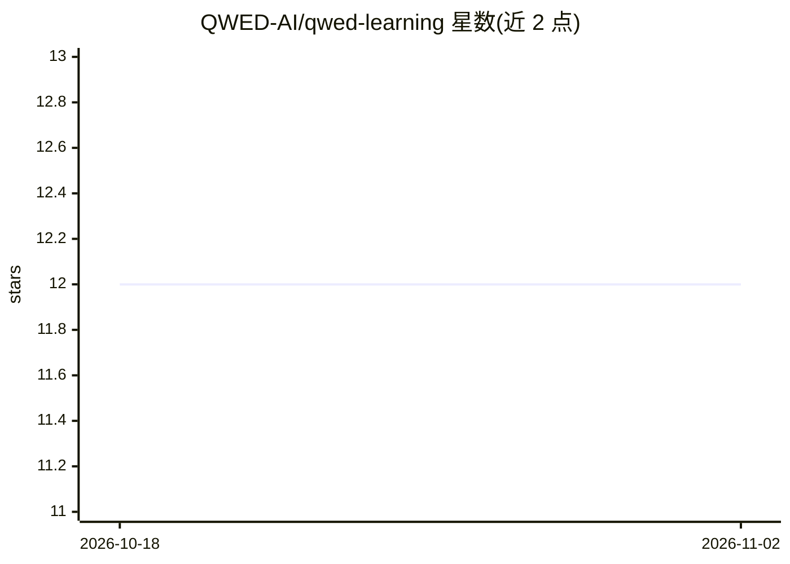

# QWED-AI/qwed-learning

⭐ 12 · Python · CC0-1.0 · 推送 2026-09-14 · [GitHub](https://github.com/QWED-AI/qwed-learning) · [官网](https://qwedai.tech) · 组织维护

**面向开发者的确定性 AI 验证与 AISecOps 免费课程**

QWED-AI 维护的免费开源课程（CC0），共 17 个模块、8-10 小时，讲授确定性 AI 验证、fail-closed 信任边界、形式化验证、MCP 安全与审计完整性。课程围绕 LLM 草稿与决策边界的分离展开：LLM 产出草稿，验证层用确定性检查区分 VERIFIED/BLOCKED/UNVERIFIABLE。按角色提供学习路径（后端开发、金融合规、AI 工程师、学生），动手部分用 QWED SDK 构建银行 agent、法律审计器与 CI/CD 验证管道。全部内容可本地 CPU 运行（Ollama）或用 OpenAI API。

## 筛选速览

| 维度 | 判定 | 备注 |
|---|---|---|
| AI 角色 | `ai-knowledge` | 知识聚合/清单类 |
| 许可风险 | `viral` | CC0-1.0 |
| 部署形态 | `None` |  |
| 模型依赖 | — | README 未给出锁定关系 |
| 硬件要求 | — | 无带数字的原话,不猜 |
| 安装摩擦 | `low` | 无编译、无系统依赖或容器化 |
| 成熟度 | — | 结构信号不足 |

## 能力要点

- 17 个模块覆盖验证理论、Agentic 安全、编排与基础设施验证
- 按角色（开发/合规/工程/科研）划分的四条学习路径
- 动手项目：验证型银行 agent、确定性法律审计器（qwed_sdk.guards）
- 无需 GPU，可用本地 Ollama 或 OpenAI API 运行

## 适用场景

- 系统学习 AI 验证与信任边界工程
- 为受监管行业的 AI 工作流建立审计级验证管道
- 了解 LLM 幻觉成因与确定性验证方法

## 场景标签

`教程课程` `网络安全` · 领域:学习与行业

## 证据(README 行号)

> L5: **Free, open-source course on deterministic AI verification, fail-closed trust boundaries, and governed agent system
> L24: - [ ] Module 0: Prerequisites _(20 min)_
> L167: ### **Module 1: The Crisis** _(30 mins)_

## 星数曲线

2026-10-18 12 → 2026-11-02 12（+0）

---
*卡片 v1 · prompt 1.4 · 生成 2026-11-01 · 置信度 high · 依据 README sha `8cc305e37e93` · [字段定义](../../DATASET.md)*
