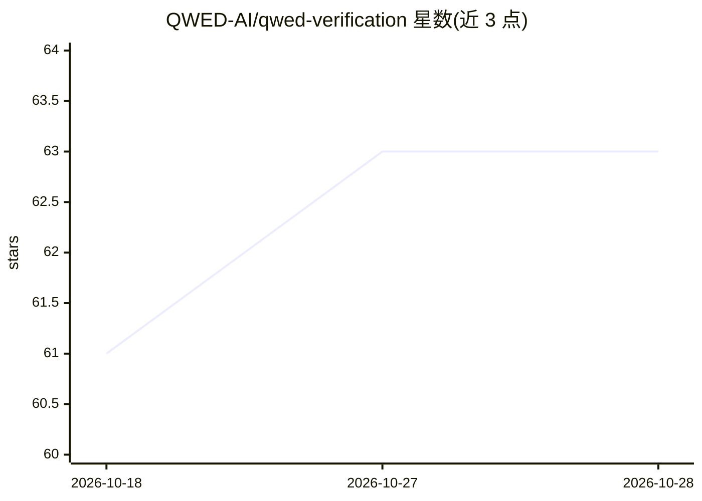

# QWED-AI/qwed-verification

⭐ 63 · Python · Apache-2.0 · 推送 2026-10-27 · [GitHub](https://github.com/QWED-AI/qwed-verification) · [官网](https://docs.qwedai.tech) · 个人维护

**LLM/AI 输出的确定性验证层：生产执行前判定可否放行**

面向开发者的开源验证基础设施（Apache-2.0），用 SymPy、Z3、SQLGlot、Python AST 等 13 个确定性引擎检查 LLM 输出、工具调用、生成代码、JSON 结构与 agent 状态，返回 VERIFIED/UNVERIFIABLE/BLOCKED 与独立的 ADMIT/DENY 放行决策，无法验证的声明绝不报告为已验证（fail-closed）。提供 Python 库、CLI、自托管 API、Docker 镜像及 TypeScript/Go/Rust SDK，附 9 个策略守卫与金融/法律/税务等领域包。限制：不检查意图，域外声明返回 UNVERIFIABLE，自然语言检查依赖 LLM 翻译且翻译本身不被验证。

## 筛选速览

| 维度 | 判定 | 备注 |
|---|---|---|
| AI 角色 | `ai-ecosystem` | LLM/agent 周边工具 |
| 许可风险 | `permissive` | Apache-2.0 |
| 部署形态 | `self-host` | docker 或自建部署 |
| 模型依赖 | — | README 未给出锁定关系 |
| 硬件要求 | — | 无带数字的原话,不猜 |
| 安装摩擦 | `low` | 无编译、无系统依赖或容器化 |
| 成熟度 | — | 结构信号不足 |

## 能力要点

- 13 个引擎（Math/Logic/SQL/Code/Schema/Symbolic 等）+ 9 个策略守卫，产出 VERIFIED/UNVERIFIABLE/BLOCKED 与 ADMIT/DENY 双重判定
- fail-closed 原则：无法确定性验证的声明不报告为已验证，VERIFIED 附 SHA-256 proof_ref
- Symbolic 引擎的 CrossHair 只在无网络、只读文件系统的 Docker 沙箱中运行
- 提供 Python 库/CLI/自托管 API/Docker 镜像及 TypeScript、Go、Rust SDK

## 适用场景

- 在生成代码或 SQL 进入生产执行前做确定性检查与放行控制
- 为 agent 工具调用（MCP/A2A）增加执行前验证
- 在自有环境内自托管 LLM 输出验证服务并审计结果

## 场景标签

 · 领域:LLM 基础设施/验证

## 证据(README 行号)

> L14: QWED is an open-source (Apache-2.0) verification layer that checks claims in LLM and AI-agent output with determini
> L16: This repository is the reference implementation of the QWED verification protocol and of Verification Context v1.0,

## 星数曲线

2026-10-18 61 → 2026-10-28 63（+2）

---
*卡片 v1 · prompt 1.4 · 生成 2026-10-24 · 置信度 high · 依据 README sha `edb3585ed7ee` · [字段定义](../../DATASET.md)*
