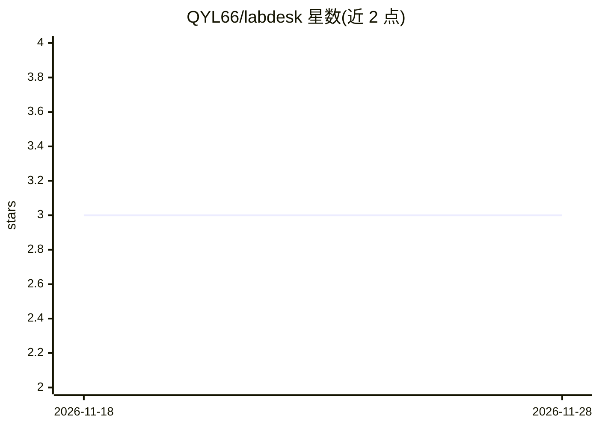

# QYL66/labdesk

⭐ 3 · Java · Apache-2.0 · 推送 2026-11-26 · [GitHub](https://github.com/QYL66/labdesk) · 个人维护 · 中文 README

**校内实验室的资料问答与设备预约助手**

面向校内实验室的 Web 工作台：管理员上传文档后经 RocketMQ 异步分块、向量化写入 PostgreSQL/pgvector；学生用自然语言查询设备操作规程与安全须知，回答流式返回并附可展开核对原文的引用。设备预约通过三个 MCP 工具实现，提交前需用户在界面确认，并发冲突由数据库唯一约束裁决。技术栈为 React/TypeScript 前端与 Java 17/Spring Boot 后端，通用 RAG、Agent 与工具确认框架来自既有底座，仅支持 Windows 本机启动。

## 筛选速览

| 维度 | 判定 | 备注 |
|---|---|---|
| AI 角色 | `ai-native` | 本体是模型或模型工具 |
| 许可风险 | `permissive` | Apache-2.0 |
| 部署形态 | `self-host` | docker 或自建部署 |
| 模型依赖 | locked-api |  |
| 硬件要求 | — | 无带数字的原话,不猜 |
| 安装摩擦 | `low` | 无编译、无系统依赖或容器化 |
| 成熟度 | — | 结构信号不足 |

## 能力要点

- RAG 问答带引用溯源，可打开原始文档核对
- 三个 MCP 工具（查空闲/确认预约/查记录）配合人工确认流程
- 数据库唯一约束处理预约并发冲突与重复提交
- Docker Compose 编排中间件，Windows PowerShell 脚本启停

## 适用场景

- 查阅设备操作规程并核对原文出处
- 查询设备空闲时段并提交预约
- 管理员上传资料并跟踪分块进度

## 场景标签

`RAG` `文档问答` · 领域:知识与检索

## 证据(README 行号)

> L5: LabDesk 面向校内实验室。学生可以查设备操作规程和安全须知，从答案打开原文，也可以查设备空闲时段，在确认后提交预约。管理员可以上传资料、查看分块进度、管理成员和检查操作记录。
> L39: - 原始文档保存在 RustFS。开始分块后，后端通过 RocketMQ 投递任务，消费者解析文档、计算向量，再写入 PostgreSQL/pgvector。
> L44: - Agent 可以通过 MCP 查询某天的空闲时段和当前用户的预约。提交预约前，界面展示设备、日期和时段，用户确认后才执行写入。

## 星数曲线

2026-11-18 3 → 2026-11-28 3（+0）

---
*卡片 v1 · prompt 1.4 · 生成 2026-11-22 · 置信度 high · 依据 README sha `5ee6d4b62040` · [字段定义](../../DATASET.md)*
