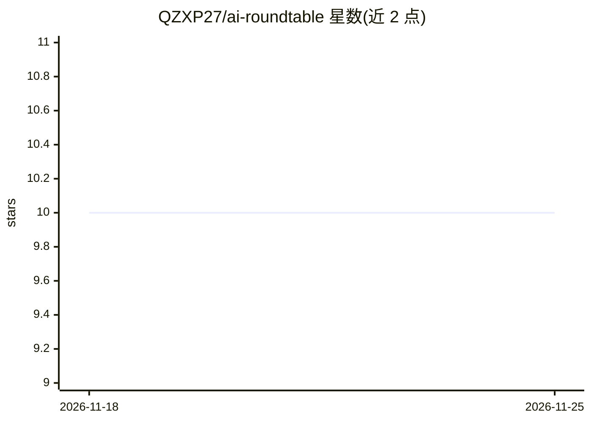

# QZXP27/ai-roundtable

⭐ 10 · Python · AGPL-3.0 · 推送 2026-08-06 · [GitHub](https://github.com/QZXP27/ai-roundtable) · [官网](https://qzxp27.github.io/ai-roundtable/) · 个人维护 · 中文 README

**本地多模型辩论室：让 Claude/Gemini/ChatGPT/DeepSeek 辩题对辩并收敛出结论**

自托管的 Web 辩论室：FastAPI + WebSocket 前端调度多个模型以指定人设轮流发言，每轮由独立选择的模型生成总结并标注收敛状态（unanimous/leaning/split/contested），收尾给出单一建议与置信度。Claude、Gemini、OpenAI 通过各自官方订阅 CLI 调用，DeepSeek 走 API。支持主持人实时插话、PDF 参考材料注入、联网搜索、会话自动保存与 Obsidian/PDF 导出。要求 macOS（两项功能在其他平台静默降级）、Python 3.11+ 与至少两个已配置的 provider。

## 筛选速览

| 维度 | 判定 | 备注 |
|---|---|---|
| AI 角色 | `ai-native` | 本体是模型或模型工具 |
| 许可风险 | `viral` | AGPL-3.0 |
| 部署形态 | `library` | 以包/库形式分发 |
| 模型依赖 | locked-api |  |
| 硬件要求 | — | 无带数字的原话,不猜 |
| 安装摩擦 | `low` | 无编译、无系统依赖或容器化 |
| 成熟度 | — | 结构信号不足 |

## 能力要点

- 每轮收敛判定与最终裁决：标注共识状态并指出解决分歧的关键点
- Claude/Gemini/OpenAI 经订阅 CLI 调用、DeepSeek 走 API 的多 provider 注册表设计
- 辩论语言自适应：总结与裁决跟随参与者实际使用的语言
- 会话自动保存为 JSON，支持 Markdown/PDF 导出与预设复用

## 适用场景

- 重大决策前让多个模型从不同人设立场互相质询
- 给自己观点做压力测试，暴露没想到的反方论点
- 附上 PDF 资料，围绕文档内容组织多模型讨论

## 场景标签

`聊天机器人` `多智能体` · 领域:Agent 开发

## 证据(README 行号)

> L5: A local, self-hosted debate chatroom where **Claude, Gemini, ChatGPT and
> L20: Asking one model a question gets you one perspective. This spins up several
> L36: Browser (WebSocket)  <->  FastAPI server  <->  DebateEngine  <->  claude -p / agy -p / codex exec

## 星数曲线

2026-11-18 10 → 2026-11-25 10（+0）

---
*卡片 v1 · prompt 1.4 · 生成 2026-11-20 · 置信度 high · 依据 README sha `ce015b79b9c5` · [字段定义](../../DATASET.md)*
