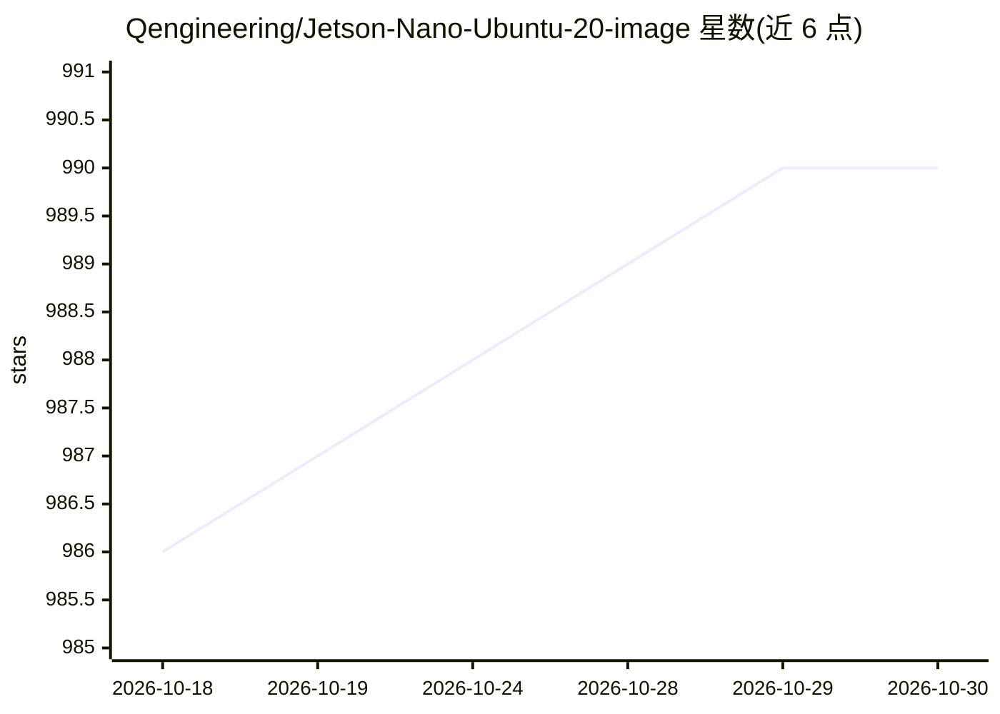

# Qengineering/Jetson-Nano-Ubuntu-20-image

⭐ 990 · BSD-3-Clause · 推送 2026-07-25 · [GitHub](https://github.com/Qengineering/Jetson-Nano-Ubuntu-20-image) · [官网](https://qengineering.eu/install-ubuntu-20.04-on-jetson-nano.html) · 个人维护

**预装深度学习框架的 Jetson Nano Ubuntu 20.04 SD 卡系统镜像**

面向 Jetson Nano 开发者的 SD 卡系统镜像：基于 Ubuntu 20.04 + JetPack 4.6.1，预装 OpenCV 4.8.0、TensorFlow 2.4.1、PyTorch 1.13.0、TorchVision、TensorRT 8.0.1.6、TeamViewer 与 Jtop，CUDA 版本为 10.2（不支持 CUDA 11）。提供完整镜像与超频裸系统两种下载，支持分卷下载、GDrive 备用源，附 VNC、headless 安装与 USB SSD 启动说明。限制：TF 2.5+/PyTorch 2.0 因 CUDA 11 无法安装；建议 64GB 以上 SD 卡。

## 筛选速览

| 维度 | 判定 | 备注 |
|---|---|---|
| AI 角色 | `ai-ecosystem` | LLM/agent 周边工具 |
| 许可风险 | `permissive` | BSD-3-Clause |
| 部署形态 | `desktop` | 安装包/桌面程序 |
| 模型依赖 | — | README 未给出锁定关系 |
| 硬件要求 | — | 无带数字的原话,不猜 |
| 安装摩擦 | `high` | 编译与系统依赖俱全 |
| 成熟度 | — | 结构信号不足 |

## 能力要点

- 预装 OpenCV/PyTorch/TensorFlow/TensorRT 等深度学习软件栈（共 21GB+）
- 提供 8.7GB 完整镜像与 5.6GB 超频裸镜像两种选择
- 14 分卷下载与 Google Drive 备用下载源
- 附 headless 安装、VNC、USB SSD 启动等操作指引

## 适用场景

- 在 Jetson Nano 上免配置直接获得可用的深度学习开发环境
- 用裸镜像自行搭建精简的 Ubuntu 20.04 + JetPack 环境
- 通过 VNC 或 headless 方式远程使用 Nano

## 场景标签

 · 领域:嵌入式/边缘 AI 开发环境

## 证据(README 行号)

> L5: ## A Jetson Nano - Ubuntu 20.04 image with OpenCV, TensorFlow and Pytorch
> L128: - OpenCV 4.8.0

## 星数曲线

2026-10-18 986 → 2026-10-30 990（+4）

---
*卡片 v1 · prompt 1.4 · 生成 2026-10-21 · 置信度 high · 依据 README sha `3e6d4b958aab` · [字段定义](../../DATASET.md)*
